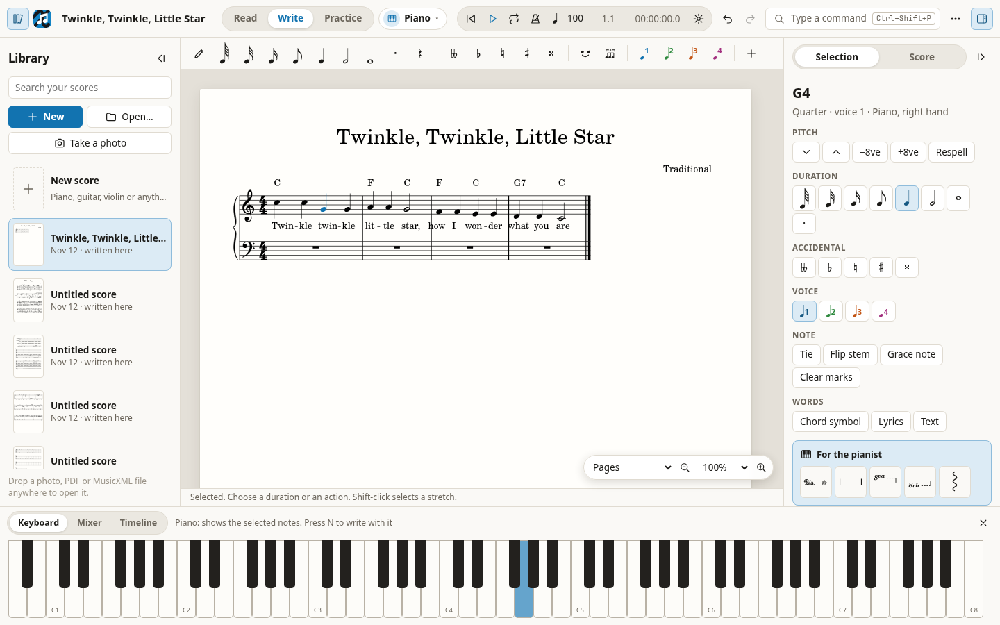
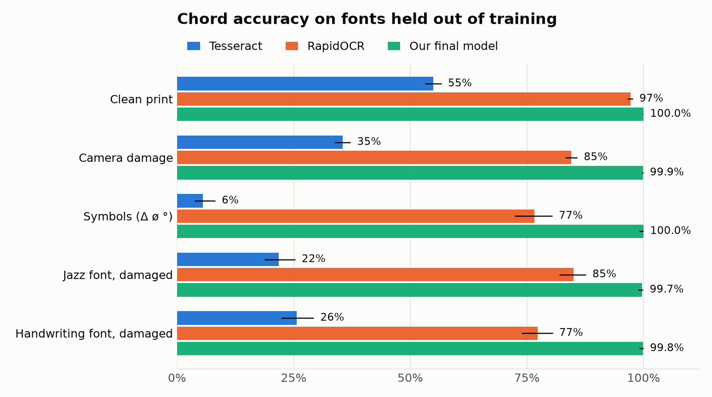
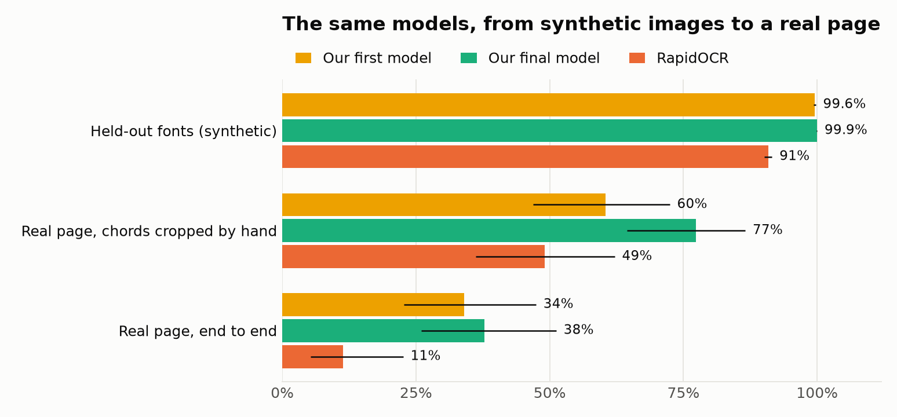

<p align="center">
  
</p>

<h1 align="center">xrnsheet</h1>

Turn a photo or PDF of sheet music into notation you can edit and reprint.

Upload a sheet, check the result beside the original, fix notes and chord symbols, then download a PDF or MusicXML. Chord symbols are read by a small model trained in this repository. Notes are read by [homr](https://github.com/liebharc/homr), or by a second small model here if the sheet has one melody per staff.

It works well on clean, computer-rendered sheets. It's weak on real handwriting, and it hasn't been tested on real phone photos or real printed pages yet. See [the project report](docs/PROJECT_REPORT.md) for the full results, and [the knowledge guide](docs/KNOWLEDGE_GUIDE.md) for the ideas behind them.



## Setup

Requires Python 3.11+ and `rsvg-convert`. Install [PyTorch](https://pytorch.org/get-started/locally/) for your machine first if you want GPU training.

```sh
python3 -m venv .venv
.venv/bin/pip install -r requirements.txt
.venv/bin/python -m chords.fonts          # download the fonts
```

The trained models are in `models/`. To make your own, see [Train the chord reader](#train-the-chord-reader) and [Train the note reader](#train-the-note-reader).

The benchmark also uses Audiveris and Tesseract. Audiveris has no Arch package, so it's unpacked into `tools/` from the official release:

```sh
mkdir -p tools/audiveris && cd tools/audiveris
curl -LO https://github.com/Audiveris/audiveris/releases/download/5.11.0/Audiveris-5.11.0-ubuntu24.04-x86_64.deb
bsdtar -xf Audiveris-*.deb && bsdtar -xf data.tar.*
rm Audiveris-*.deb data.tar.* control.tar.* debian-binary
```

Tesseract needs `eng.traineddata` in `/usr/share/tessdata`.

## Use the app

```sh
.venv/bin/python -m app.server
```

Open <http://127.0.0.1:8000>. A page takes 15 to 30 seconds on CPU. PDFs can have up to 40 pages. If a page can't be read, it's left out and the app says which one. Your sheets are listed in the library, so you can come back to them.

To read notes with the model in this repository and not homr, which only works for one melody per staff:

```sh
.venv/bin/python -m app.server --notes own
```

You can also open a `.musicxml`, `.xml` or `.mxl` file from another program the same way as a photo, and it goes straight to the editor.

### As a desktop app

On Linux, xrnsheet can also be installed as an app of its own, with its own window and a place in the app launcher. It needs the [Setup](#setup) above and Node.js 24:

```sh
cd desktop
npm run app:install
```

This builds `~/Applications/xrnsheet.AppImage` from the last commit and adds it to the launcher. Run it again to update. The app starts its own copy of the server when it opens and stops it when it closes, so nothing needs to be running first.

- **Your scores** are kept in `~/.local/share/xrnsheet/jobs`, not in the checkout, so they stay through updates and branch changes.
- **Python:** the app runs on this checkout's `.venv`, where the 6 GB of PyTorch already is, rather than carrying a copy. Set `XRNSHEET_PYTHON` before installing to use another one.
- **Opening files:** `.musicxml` and `.mxl` files offer xrnsheet under "Open with", and `xrnsheet.AppImage song.mxl` opens one from a terminal. If the app is already open, the file opens there.
- **Keys:** Ctrl+T, Ctrl+Shift+P, F6 and the other keys a browser tab keeps for itself all reach the score. Ctrl+Q quits.
- **If it won't start**, the window says why, and the server's log is `~/.local/state/xrnsheet/server.log`.

`npm start` in `desktop/` runs the app straight from the checkout, and `npm test` and `npm run test:window` check it. `test:window` starts the real app headless with a throwaway scores folder.

### The editor

The window is built round the instrument you play, piano, guitar or violin, and has three modes, switched at the top or with Alt+R, Alt+W and Alt+P:

- **Read** shows the score and nothing else, a whole page at a time, or the page's width on a phone. Space, Page Down or → turns the page, Shift+Space, Page Up or ← turns back, and so does a click on the right or left half of the score. A page-turning pedal works, as it sends those keys. Home and End go to the first and last page. While the score plays, the page turns to follow it. Nothing can be changed by accident, and N starts writing.
- **Write** has the note input bar above the score, the inspector on the right and the instrument below.
- **Practice** has the practice tools above the score and the instrument below, lit as the notes sound.

The mode is kept for next time, and Read keeps its own zoom.

**The top bar** has the score's title (click it to change the title and composer), the mode, the instrument switcher, playback, undo and redo, the command palette, the menu (⋯) and buttons for the library and the inspector.

- **The instrument switcher** lists the score's parts by their kind, such as "Piano · keyboard" or "Violin · fingerboard". The chosen part is the one the panel below shows and practice follows. Selecting a note also chooses its part.
- **Playback:** Rewind, Play, Loop, the metronome, the tempo, which opens the speed, from 10% to 300% of the written tempo, the position as a measure and beat and as a time, and the playback settings. Play starts from the playback position: wherever you last selected a note or rest, typed a measure and beat or a time into the counters, rewound, or stopped. While entering notes it starts where the next note goes. Loop goes round the selection, or the whole score if nothing is selected, between flags drawn on the page. The metronome ticks each beat, a dotted one in 6/8, 9/8 and 12/8, higher on the first of each bar, and exported audio has it while it's on. The settings turn the chord symbols off or on and set either end of the loop at the selected note.
- **The command palette** (Ctrl+Shift+P, or the box in the top bar) finds any action by typing part of its name, such as "stacc", "key d" or "practice mode", and shows its key. Enter runs it. It has every menu item, every mark, note action and mode, the practice tools, the instruments and your scores. In Write, `/` opens it when no note is chosen; with a note chosen `/` still adds a grace note. In Read and Practice `/` always opens it. Firefox and browsers made from it keep Ctrl+Shift+P for a private window, so use `/` or the box there.
- **The menu** (⋯) has File, Edit, View, Add, Format, Tools and Help, each opening beside it. Help ▸ Keyboard shortcuts lists every key.

**The library** is on the left: your scores as pictures of their first pages, with a search box, New, Open (a photo, a PDF or a MusicXML file) and Take a photo, which uses a phone's camera. With no score open it fills the window. Beside an open score it's a list with the open one marked, and it folds away with « or F6. A file dropped anywhere on the window opens.

**New score:** Piano, Guitar and Violin are a click away at the top. The rest of the instruments are chosen by family or by searching, as before: woodwinds from piccolo to contrabassoon with the clarinets and saxophones, accordion, brass, pitched percussion, voices, keyboards, guitars, basses, harp, ukulele, mandolin and banjo, and the bowed strings, each with its clefs and transposition. Then come the key, time signature, tempo, number of measures, pickup, title and composer. A drum kit and other unpitched percussion aren't there yet, as the score only holds pitched notes.

A score read from a photo or PDF also has the original sheet beside it, in every mode, with a box round each chord it found, the chords to check, and "Mark as checked". The inspector's Score tab, or View ▸ Original sheet, hides or shows it.

**The inspector** shows what's selected, and everything that can be done to it:

- **A note or rest:** its name as the page shows it, such as F♯4, or a chord's notes, its length, voice, instrument, and for a piano which hand. Then its pitch (a semitone or an octave up or down, respell), length, accidental and voice, tie, stem, grace note and clearing its marks, a chord symbol, lyrics and text. A box for the instrument has its own marks: a pianist's pedal, octave lines and arpeggio, a violinist's up and down bow, slur, staccato and tenuto, a guitarist's arpeggio and slur. Below are the marks in groups that open and close: dynamics and hairpins, articulations, text, ornaments, breaths and pauses, arpeggios, and lines (slurs, hairpins, endings, 8va and 15ma above and below, and the sustain pedal as "Ped." and a star or as a line).
- **Its measure:** the key, time and tempo in force there and its barline, with groups to change each: clefs (treble, bass and C clefs with their 8va, 8vb, 15ma and 15mb forms, the French violin, soprano, mezzo-soprano, baritone and subbass clefs, and a percussion clef that reads like a treble clef), key signatures, time signatures with common and cut time, tempo, repeats and jumps, and barlines. A key or time signature applies from the measure, and a barline goes at its end. Then Insert, Delete and New line here, Remove beat and Insert beat, and the pickup.
- **A mark** such as a dynamic, slur or text: what it is and says, Edit text and Delete.
- **Nothing selected, or the Score tab:** the title and composer to type, the instruments with Add, Remove and Parts, the key and time signature from the start, Concert pitch and the original sheet, Page settings, Spacing and Measures per line, Transpose, and Print and export to PDF, MusicXML, MIDI or audio.

F8 shows or hides the inspector on the selection, F7 on the score. On a narrow window it opens over the score.

**The instrument** below the score is the chosen part's: a piano's 88 keys, a guitar's fretboard (six strings in standard tuning, open to the 19th fret, with the inlays), or a violin's fingerboard (G, D, A and E, the open string to the fourth finger in fifth position, with first to fifth position marked and first position's finger tapes). A part of any other kind gets the keyboard. It lights the selected notes in blue, and while the score plays its notes in amber as they sound. A guitar's notes are shown where they're most easily played together, each chord on strings of its own, and a violin's in the lowest position, with the finger number. While entering notes, a key, a fret or a place on a string writes that note, and Shift adds it to the chord, as a MIDI keyboard does; otherwise it's only heard. A key is the pitch the staff shows, so at concert pitch it's the one a transposing instrument sounds. Ctrl and the mouse wheel over the keyboard make the keys wider or narrower. The panel's tabs show the mixer or the timeline in its place, and P, F10 and F12 show or put away the instrument, the mixer and the timeline.

**Practice:**

- **Loop:** A and B (the keys, or the buttons) set the loop's start and end at the selected notes, or Loop goes round the selection.
- **Speed**, from 25% to 150% here, or 10% to 300% from the tempo.
- **Count in** one or two bars, ticking every beat and higher on the first, with the count shown.
- **Metronome.**
- **Hear** everything, one part alone, or one hand of a piano: its upper staff is the right hand and its lower the left.
- **Wait for** a part or one hand: Play then stops at each of those notes until you've played them, on a MIDI keyboard or on the instrument below, and the rest of the music plays along in time between them. The notes it's waiting for are purple on the page and outlined on the instrument, and a wrong note is named. A chord can be played in any order, and notes played a little early count.

**Entering notes.** Press `N`, pick a duration, and type the letters, click the staff, or play the instrument below. A new measure appears when you write past the last one. A longer note overwrites what comes after it and a shorter one leaves a rest, so every measure stays full. A note too long for its measure carries into the next one, tied. A MIDI keyboard works while entering notes, and keys pressed together make a chord. On a phone, buttons for C to B and a rest show while entering notes.

**Selecting.** Click a note or rest. Shift-click another to select the stretch between them, which gets a blue box. Click an empty part of a measure to select the whole measure. A stretch moves, deletes or copies as one undo step, within one voice. Click a dynamic, tempo, text, sign, slur, hairpin, octave line or pedal to select it: Delete removes it, and a double-click or `F2` changes its text. A right-click opens a menu for whatever is under the pointer.

**Instruments and parts.** The inspector's Score tab adds and removes instruments, and a transposing instrument gets its own key: the key chosen for a new score is the one it sounds in, so a B♭ trumpet in concert C reads D major. "Parts" opens one instrument alone as a PDF.

**Views.** The buttons at the bottom right of the score show it as pages, as one line across, without the title, or as one long page down, and zoom it. Selecting, entering notes and every key work the same in each, and the score keeps its view, which isn't an edit to undo. Printing and PDFs are always in pages. The one-line view doesn't keep the instrument names and clefs in sight as it scrolls.

**Concert pitch.** The inspector's Concert pitch button, or View ▸ Concert pitch, shows transposing instruments as they sound instead of as their players read them. An instrument written an octave from how it sounds, such as a bass guitar or a tenor saxophone, keeps its notes in place and takes a clef with an 8 below. Notes, chords and keys entered at concert pitch are the ones that sound, and the score keeps them written for the player. The choice is saved with the score and can be undone. Printing and PDFs follow it, while MusicXML is always written for the players, and MIDI and audio always sound the same. A key signature chosen for a transposing staff is the key that staff shows, and notes copied from one instrument and pasted into another sound the same.

| Key | Action |
|---|---|
| `N` | Start or stop entering notes. In Read or Practice, start writing |
| `A` to `G` | While entering notes, write that note and move on. On a selected note, rename it |
| Shift+`A` to `G` | Add that note to the chord |
| Alt+`2` to `9` | Add a note that interval above |
| `1` to `7` | Duration, from a 64th to a whole note. `5` is a quarter note |
| `Q` `W` | Half or twice as long. With Shift, step through the dotted lengths |
| `.` | Dotted |
| `0` | Rest |
| `T` | Tie to the next note |
| Ctrl+`3` | Make a triplet from the chosen duration, or take one away. Ctrl+`5`, `6` and `7` make other tuplets |
| `+` `-` `=` | Sharp, flat, natural. `#` is also sharp |
| ↑ ↓ | Move a note a semitone. With Ctrl, an octave. With Alt+Shift, one step of the scale |
| ← → | Previous or next note. With Ctrl, previous or next measure |
| Ctrl+Home, Ctrl+End | First or last note of the staff |
| Shift with any of those, Shift+click | Select a stretch of notes |
| Ctrl+A | Select the whole staff |
| Ctrl+C, Ctrl+X, Ctrl+V | Copy, cut, paste, also between scores |
| `R` | Repeat this note or stretch |
| Delete | Turn into a rest, or remove a selected mark |
| Ctrl+Delete | Remove the selected time: measures selected from end to end go, and less than a measure pulls the later notes in |
| Insert, Ctrl+B | Insert a measure before the selection, or add one at the end |
| Ctrl+L | Type lyrics. Space moves on, `-` joins syllables, ↓ ↑ change verse, Enter finishes |
| Ctrl+K | Chord symbol |
| Ctrl+T, Ctrl+E, Ctrl+M | Staff text, expression text, rehearsal mark |
| Alt+Shift+T | Tempo marking |
| `S` | Slur a stretch, or this note to the next |
| `<` `>` | Crescendo, diminuendo over a stretch |
| Shift+`S` `V` `N` `O` | Staccato, accent, tenuto, marcato |
| `/` | Add a grace note before this note. With no note chosen, or in Read or Practice, find a command |
| `J` | Swap for the same note under another name, as C♯ for D♭ |
| `X` | Flip the stem |
| Ctrl+Alt+`1` to `4` | Write in that voice, or move the selection to it |
| Enter | Start a new line at this measure, or open a selected mark's text |
| Space | Play or stop, from the playback position. In Read, turn the page |
| Ctrl+Z, Ctrl+Y | Undo, redo |
| Ctrl+Shift+P | Find any action by name, with its key |
| Alt+R, Alt+W, Alt+P | Read, Write, Practice |
| Space, Page Down, → ↓ | In Read, the next page. Shift+Space, Page Up and ← ↑ go back, Home and End to the first and last |
| `A` `B` | In Practice, start or end the loop at the selected note |
| `F6` | Show or hide the library |
| `F8`, `F9` | Show or hide the inspector, on the selection |
| `F7` | The inspector on the score: its title, instruments and pages |
| `P` | Show or hide the instrument: keyboard, fretboard or fingerboard |
| `F10` | Show or hide the mixer |
| `F12` | Show or hide the timeline |
| Ctrl+`=`, Ctrl+`-`, Ctrl+`0` | Zoom in, zoom out, 100%. Ctrl and the mouse wheel also zoom |
| Esc | Stop entering notes, clear the selection, or close a menu or box |
| Click the staff | While entering notes, place a note there. Shift+click adds it to a chord |
| Drag a selected note | Move it up or down |
| Drag the paper | Move the pages about |
| Double-click the title | Change the title and composer |

The keys are MuseScore's where MuseScore has one. A browser keeps a few for itself: in an ordinary tab Ctrl+T opens a new tab, so use the inspector's Text button or Add ▸ Text ▸ Staff text there; some browsers open their own menu on `F10` or put the focus in the address bar on `F6`, so use the command palette or View there; and most open their developer tools on `F12`, so use View ▸ Timeline. In the desktop app every key reaches the score.

Measures that don't add up to the time signature are listed above the score in Write, which is usually how a misread rhythm shows itself. Click one to go there, then fix it with Remove beat or Insert beat in the inspector. A new time signature doesn't move notes between measures: the ones that no longer fit are listed for you to fix.

Play sounds the notes and the chord symbols. It follows repeats, first and second endings, D.C. and D.S. with Fine and Coda, tempo changes, dynamics and hairpins, swing, articulations and ornaments, and the sustain pedal.

An 8va line keeps the notes under it at the pitch they sound, which is how MusicXML and MuseScore store them, and draws them an octave lower. A note clicked onto the staff under one is the note an octave above where it's drawn.

**Mixer.** The panel's Mixer tab, or `F10`, has a strip for each instrument, the chord symbols, the metronome and the master: a pan, a fader from −∞ to +12 dB, and mute and solo. Double-click a pan or fader to put it back. Playback follows it as it moves, and exported audio is mixed the same way, in stereo. The score keeps the mixer, but moving it isn't an edit to undo. MusicXML takes each instrument's volume and pan, and brings them back when it's opened, and MIDI takes them as volume and pan controllers. Mute and solo are only for listening, so no file keeps them.

**Timeline.** The panel's Timeline tab, or `F12`, shows the whole score, a column for each measure: rows for where the tempo, time signature, rehearsal marks, key signature, barlines and jumps change, then a row for each instrument, filled where it has notes. Click a measure to select it on that instrument, or Shift+click to stretch the selection to it. While entering notes a click moves the cursor there.

Tools ▸ Transpose moves the selection, or the whole score if nothing is selected, to a key or by an interval, and the chord symbols move with it. Format ▸ Measures per line sets how many measures go on a line.

**Page settings and spacing.** Format ▸ Page settings, or the inspector's Score tab, sets the paper, from MuseScore's sizes (A4, Letter, Legal, Tabloid, A3, A5, B4, B5, Executive and Concert) or any size, portrait or landscape, its four margins, and the staff space, which scales the music. Spacing sets the room between instruments' staves and between systems. Both are edits that can be undone. The score keeps them as MusicXML does, in its `<defaults>`, so they're exported with it, and a MusicXML file from another program opens on the page it sets out. A score read from a photo starts on A4 whatever its reader guessed.

A staff can hold four voices. Choose one with the coloured buttons or Ctrl+Alt and a number, and the arrows stay in that voice. If you write a rest in an extra voice, it stays there so you can carry on, and Delete removes it.

To write a triplet, pick the duration it should fill, press Ctrl+`3`, and type its three notes. A quarter gives eighth-note triplets. A triplet can't be cut in half, so selecting or copying any note of one takes the whole triplet.

Repeats & jumps starts or ends a repeat at the selected measure, and marks it as a first or second ending. Select several measures to put one ending over all of them. A title recognition guessed isn't printed until you save it in the inspector or File ▸ Title and composer.

Click a chord symbol to change or remove it. Doubtful chords are coloured and listed under "Please check". "Clear marks" removes a false fermata or ornament from a note. "Mark as checked" tells the app you've finished with a sheet, which makes it usable as training data. Measures you added or deleted are allowed for, so a chord that only moved isn't treated as a misread one.

**Speed.** Only the pages an edit changes are drawn again, the server keeps its last few drawings, so going back to a score, undoing and redoing are quick, and the window is sent only the music symbols it draws. `bench/editor_speed.py` measures how long a score takes to open and an edit to show, and what the window loads.

What MuseScore has and this editor doesn't yet: unpitched percussion such as a drum kit, the rest of MuseScore's Style dialog beyond the page's spacing, and, in the one-line view, instrument names and clefs that stay in sight as it scrolls. Guitar tablature, fingering, string numbers and bowing are coming, and the inspector and the fretboard have their places ready.

To recognize a sheet without the app:

```sh
.venv/bin/python -m pipeline.recognize photo.jpg --out results/photo
```

## Guitar, violin and piano notation

What a score can hold for these players, all of it stored as MusicXML, so it opens in MuseScore and
other programs. [docs/instrument-api.md](docs/instrument-api.md) lists the server's endpoints.

- **Guitar and bass tablature.** "Guitar + tablature" and the acoustic, electric and bass versions
  have a TAB staff under the standard staff, as in MuseScore. Every note on the TAB staff is
  played by a string and fret, chosen as a player would (open strings low on the neck, near where
  the hand already is, a chord on strings of its own) or set per note. Tunings: standard, drop D,
  DADGAD, open G, open D, half a step down, or any other, and a capo from the 1st to the 12th
  fret. A new tuning or capo keeps the notes' sound and moves their frets. Notes no string can play
  are listed, and left off the tablature.
- **Chord diagrams** over the chord symbols, which a score shows or doesn't: the open and barre
  shapes guitarists learn, worked out for other chords and tunings, and fingered from the capo.
  MusicXML files carry them as `<frame>`s.
- **Guitar techniques:** hammer-ons and pull-offs with their H and P, slides and glissandos, bends
  of ½, full or 1½ tones, vibrato, palm mute and let ring lines, natural and artificial harmonics,
  dead notes, right-hand p-i-m-a, left-hand fingers 0 to 4 and string numbers in circles. They show
  on the tablature too, and playback plays them.
- **Violin:** up- and down-bows, strings as Roman numerals or "sul G", fingers 0 to 4, positions
  ("III pos."), "pizz." and "arco", which playback follows, harmonics and open strings.
- **Piano:** fingers 1 to 5, above the right hand and below the left, typed one note after another,
  R.H. and L.H., and notes drawn on the other staff for the other hand, which stay in their own
  staff's voice and are saved as MusicXML has them.
- **Playback** says which part and staff each note is on, so one hand of a piano can be heard alone.

## Train the chord reader

```sh
.venv/bin/python -m chords.testset                                                  # build the test crops
.venv/bin/python -m chords.baselines                                                # score Tesseract and RapidOCR
.venv/bin/python -m chords.train --name chord_reader --hand-layout 0.35 --negatives 0.2
.venv/bin/python -m chords.evaluate --name chord_reader                             # score the model
```

Training takes about 34 minutes on a 4 GB GPU. Add `--no-damage` to repeat the ablation. Training data is generated as it runs, and 5 fonts are held out for testing.

## Train the note reader

```sh
.venv/bin/python -m notes.render      # generate the strips, about an hour of CPU time
.venv/bin/python -m notes.train       # about 60 minutes on a 4 GB GPU
.venv/bin/python -m notes.evaluate    # score it on the two held-out music fonts
```

The best checkpoint is saved as training runs, so a stopped run still leaves a usable model.

## Retrain on your own corrections

After you've pressed "Mark as checked" on some sheets:

```sh
.venv/bin/python -m chords.corrections       # gather checked sheets into data/corrections/
                                             # (add --jobs ~/.local/share/xrnsheet/jobs for the desktop app's)
.venv/bin/python bench/real_report.py        # how the app did on the held-out sheets
.venv/bin/python -m chords.retrain           # train a candidate and report on it
.venv/bin/python -m chords.retrain --promote # also replace the live model if it passes
```

About one sheet in five is held out, chosen by a hash. A candidate replaces the live model only if there are at least 30 held-out chords, it gains more chords than it loses with p below 0.05, and it stays at 0.99 or above on the synthetic test. So far, a few dozen real corrections haven't been shown to help. See [the project report](docs/PROJECT_REPORT.md).

## Run the benchmark

```sh
.venv/bin/python bench/make_samples.py     # build test images and correct answers
.venv/bin/python bench/run_engines.py      # run each engine and print the scores
.venv/bin/python bench/make_figures.py     # redraw the report's charts
```

Add `--only chart --engine xrnsheet` to run part of it, or `--cached` to re-score existing outputs without running any engine. `bench/repair_report.py` shows what the bar repairs change, and `bench/real_page.py` scores the real handwritten page, which its opening comment explains how to fetch. Finished runs are cached in `results/`, so delete `results/xrnsheet` after changing the pipeline or the model. The `own_notes` engine runs the same pipeline with no homr, and isn't part of the default run.

To compare another app, export its result for each image as `data/external/soundslice/<image name>.musicxml`, then add `--engine soundslice`.

## Test your own sheets

1. Put photos or scans in `data/my_sheets/`.
2. Run `.venv/bin/python bench/run_engines.py`. The MusicXML appears in `results/`, ready to open in MuseScore.
3. To score a sheet, correct its MusicXML in MuseScore and save it as `data/truth/<same name as the image>.musicxml`.

To get a real photo score without correcting anything by hand, print a benchmark image such as `data/images/chart_00__clean.png`, photograph it, and save the photo as `data/my_sheets/chart_00__myphoto.jpg`. The name before `__` links it to its correct answer.

Scores on real photos count for far more than the simulated ones.

## What the scores mean

- **pitch**: F1 score for correct pitches, ignoring rhythm.
- **no-oct**: the same, ignoring octave. A big gap between this and **pitch** usually means one misread clef moved every note.
- **note**: F1 score for correct pitch and duration together.
- **chords**: share of chord symbols read with the right root and quality.
- **placed**: share also attached to the right measure and beat.

## Latest results

From 2026-11-06, on synthetic pages. Notes are `note` F1 scores, and chords show recall / placement. In this table, xrnsheet's notes come from homr.

| Sheets | Notes: xrnsheet | Notes: Audiveris | Chords: xrnsheet | Chords: Audiveris |
|---|---|---|---|---|
| Spelled jazz charts, clean (10) | 1.00 | 0.99 | 0.93 / 0.88 | 0.25 / 0.19 |
| Spelled jazz charts, simulated photo (10) | 1.00 | 0.92 | 0.93 / 0.87 | 0.16 / 0.08 |
| Lead sheets, clean (3) | 1.00 | 1.00 | 1.00 / 0.96 | 0.63 / 0.63 |
| Lead sheets, handwritten-style font (3) | 1.00 | 0.89 | 1.00 / 1.00 | 0.53 / 0.53 |
| Lead sheets, simulated photo (3) | 1.00 | 0.87 | 0.98 / 0.98 | 0.43 / 0.30 |
| Classical, clean (5) | 0.97 | 0.95 | n/a | n/a |
| Classical, handwritten-style font (5) | 0.93 | 0.51 | n/a | n/a |
| Classical, simulated photo (5) | 0.82 | 0.27 | n/a | n/a |

These aren't real-world accuracy. homr was trained on images much like these, so its scores are likely inflated. On one real handwritten page, the pipeline found 20 of 53 chords.

The note reader in this repository (`--notes own`), on the same synthetic pages:

| Sheets | Notes: own reader | Notes: homr | Chords placed: own reader | Chords placed: homr |
|---|---|---|---|---|
| Spelled jazz charts, clean (10) | 1.00 | 1.00 | 0.93 | 0.88 |
| Spelled jazz charts, simulated photo (10) | 1.00 | 1.00 | 0.88 | 0.87 |
| Lead sheets, clean (3) | 1.00 | 1.00 | 1.00 | 0.96 |
| Lead sheets, handwritten-style font (3) | 0.99 | 1.00 | 1.00 | 1.00 |
| Lead sheets, simulated photo (3) | 1.00 | 1.00 | 1.00 | 0.98 |
| Classical, all conditions (15) | 0.12 | 0.91 | n/a | n/a |

It reads one melody per staff, which is why classical music scores so low, and why homr stays the default. It takes about 4 seconds a page. It reads hand-style time signatures badly, and the notes score doesn't measure that. On real handwriting it found only a small share of the notes.

### The chord reader alone

On chord crops in fonts it never trained on, against two general OCR engines, and then how much of
that holds up on a real handwritten page. That page shaped the fixes, so its numbers are a
development result, not a clean accuracy.





## Licences

Check these before shipping a commercial product.

| Component | Licence | Note |
|---|---|---|
| homr, Audiveris | AGPL-3.0 | Running them as a closed online service may require sharing source code. `--notes own` runs with no homr, for melody sheets only |
| Verovio | LGPL-3.0 | |
| music21 | BSD-3-Clause | The benchmark pieces come from its corpus, and two tests open a chorale from it. Corpus files aren't copied into this repository |
| RapidOCR | Apache-2.0 | |
| Fonts in `data/fonts/` | SIL Open Font License | Used to generate training images |
| JAZZMUS dataset | CC BY-NC 4.0 | Not used here. It's non-commercial, and access must be requested |
