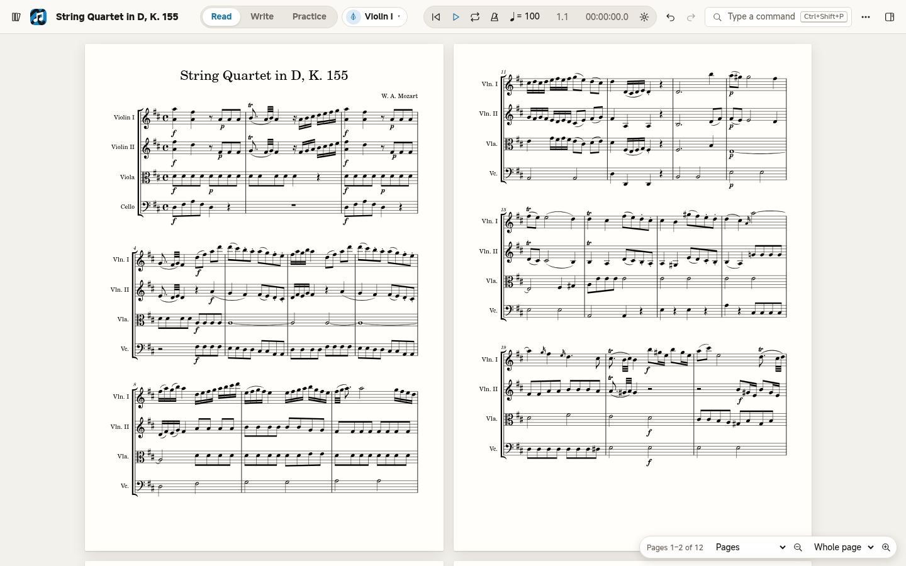
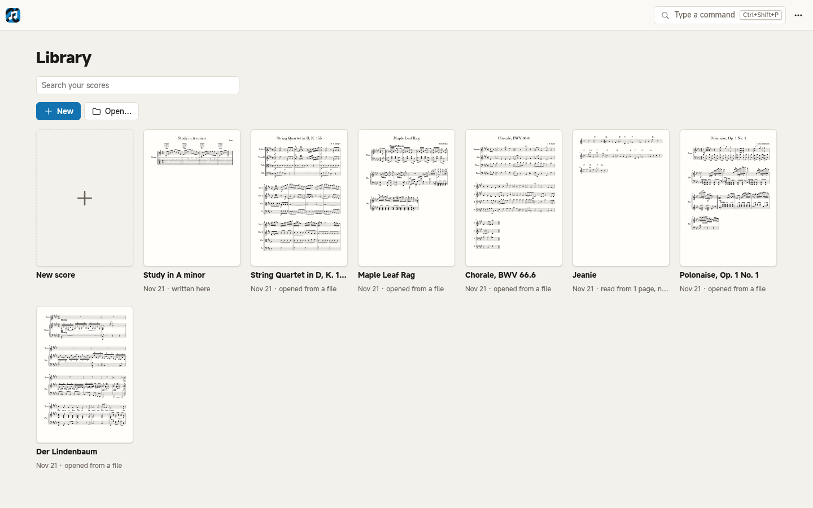
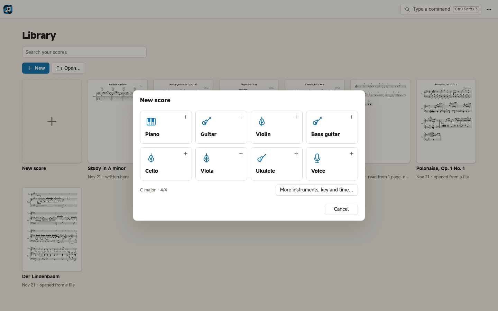
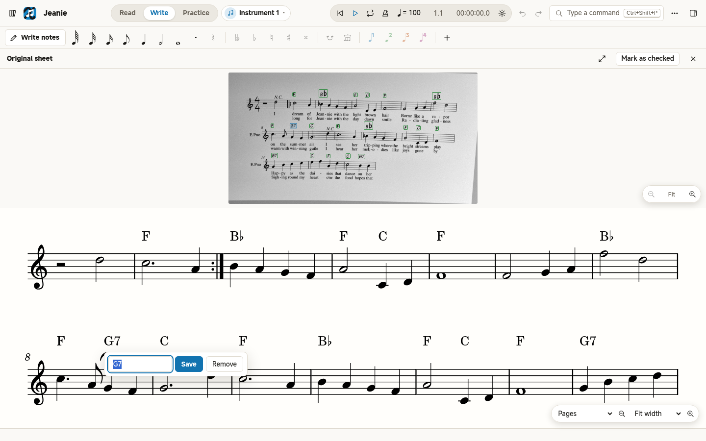
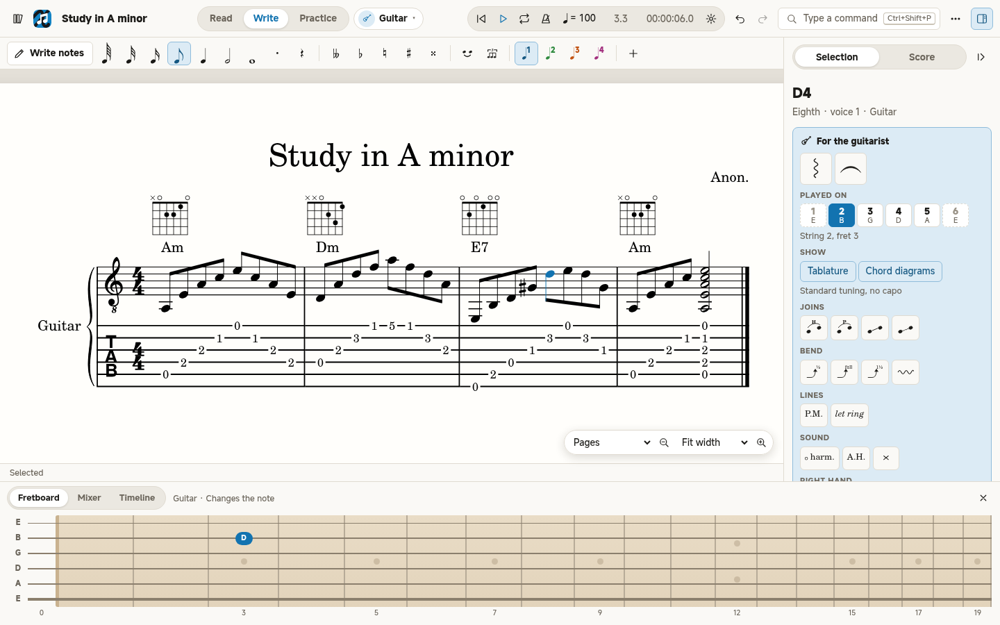
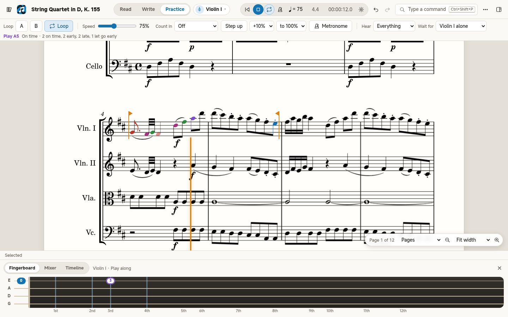

<p align="center">
  
</p>

<h1 align="center">xrnsheet</h1>

Turn a photo or PDF of sheet music into notation you can edit and reprint.

Upload a sheet, check the result beside the original, fix notes and chord symbols, then download a PDF or MusicXML. Chord symbols are read by a small model trained in this repository. Notes are read by [homr](https://github.com/liebharc/homr), or by a second small model here if the sheet has one melody per staff.

It works well on clean, computer-rendered sheets. It's weak on real handwriting, and it hasn't been tested on real phone photos or real printed pages yet. See [the project report](docs/PROJECT_REPORT.md) for the full results, and [the knowledge guide](docs/KNOWLEDGE_GUIDE.md) for the ideas behind them.


*Write mode: a selected note, the inspector's pianist's box, and its key lit on the piano below. The screenshots here use public-domain music and a made-up study.*

## Setup

Requires Python 3.11+ and `rsvg-convert`. The app's `.venv` is made on Python 3.14, the version in `.python-version`, with the exact versions in `requirements.lock`:

```sh
python3.14 -m venv .venv
.venv/bin/pip install torch==2.15.0 --index-url https://download.pytorch.org/whl/cpu   # PyTorch without the GPU parts
.venv/bin/pip install -r requirements.lock
.venv/bin/python -m chords.fonts          # download the fonts
python3 tools/fetch_models.py             # download the trained readers into models/
```

`requirements.txt` names what xrnsheet uses; `requirements.lock` is `pip freeze` of a `.venv` it's known to work with, less PyTorch. A `.venv` runs on the Python it was made with, so when the system's Python moves to a newer version, `.venv` and the desktop app stop working. Make it again on 3.14 from mise: `mise install python@3.14`, then `mise exec python@3.14 -- python -m venv .venv` in place of the first line.

The app reads every page on the CPU, with its two models exported to ONNX and run in onnxruntime, so reading a page doesn't load PyTorch. `.venv` still takes PyTorch's CPU build, under 2 GB in all, for the tests, for `bench/real_page.py`, and to read with a model that hasn't been exported. The default build carries 5 GB of GPU libraries that only [training](#train-on-a-gpu) uses.

The trained models go in `models/`: the `.pt` that training writes, and the `.onnx` exported from it that the app reads. They're files of a [release](https://github.com/Xernnn/xrnsheet/releases/tag/models-2026-11-17), not of git; `models/models.json` names them with their SHA-256, `tools/fetch_models.py` checks each, and `--onnx` fetches only what the app needs. To make your own, see [Train the chord reader](#train-the-chord-reader) and [Train the note reader](#train-the-note-reader).

homr's own three models are fetched into its folder in `.venv` the first time a page is read with homr, from homr's release. `pipeline/homr_models.py` pins their SHA-256s: a download is kept only if it matches, and a page isn't read with a model that differs.

The benchmark also uses Audiveris and Tesseract. Audiveris has no Arch package, so it's unpacked into `tools/` from the official release:

```sh
mkdir -p tools/audiveris && cd tools/audiveris
curl -LO https://github.com/Audiveris/audiveris/releases/download/5.11.0/Audiveris-5.11.0-ubuntu24.04-x86_64.deb
bsdtar -xf Audiveris-*.deb && bsdtar -xf data.tar.*
rm Audiveris-*.deb data.tar.* control.tar.* debian-binary
```

Tesseract needs `eng.traineddata` in `/usr/share/tessdata`.

## Use the app

```sh
.venv/bin/python -m app.server
```

Open <http://127.0.0.1:8000>. `--port` serves it on another port. The server only answers on this computer: it's bound to 127.0.0.1 and turns away requests made for any other host name, so a phone on the same network can't open it. A page takes 10 to 40 seconds on a laptop's CPU, the longer for a full page of piano music, or 2 to 3 with `--notes own` below. PDFs can have up to 40 pages. Photos opened or dropped together, up to 40, are read as the pages of one score, in the order of their names, so a piece photographed page by page is one score. If a page can't be read, it's left out and the app says which one. A PDF that asks for a password says so; open a copy saved without one. Your sheets are listed in the library, so you can come back to them.

Each score is a folder of its own in `data/jobs/` in the checkout, or in the folder given with `--jobs`: the photos or PDF it was read from, what the reader found, and every version an edit saved. The last 100 versions are kept to undo to, and the first, so undo goes back through the last hundred edits and then to the score as it began. Each score has its own address, so the browser's Back and Forward go between the library and the scores opened, and an address whose score has been deleted opens the library and says "Not in the library". Nothing leaves the computer: there's no account, sync or server elsewhere.

The rest of the app can be used while a sheet is read. It's in the library at once, as a tile saying how it's getting on: waiting its turn, and behind how many, as sheets are read one at a time; or the page being read and the time so far. Opened, it shows the same, and opens into the score when it's done. Cancel, on either, stops the reading and removes the sheet; the pages of a PDF read so far go with it. A sheet read while you were elsewhere says so, with Open, and one that couldn't be read stays in the library saying why, with Try again and Remove.

To read notes with the model in this repository and not homr, which only works for one melody per staff:

```sh
.venv/bin/python -m app.server --notes own
```

You can also open a `.musicxml`, `.xml` or `.mxl` file from another program the same way as a photo, and it goes straight to the editor, with its title and composer, even from a file that only prints them on its first page, as MuseScore 2's do. The library says it was opened from a file.

### As a desktop app

On Linux, xrnsheet can also be installed as an app of its own, with its own window and a place in the app launcher. It needs the [Setup](#setup) above and Node.js 24:

```sh
cd desktop
npm run app:install
```

This builds `~/Applications/xrnsheet.AppImage` from the last commit and adds it to the launcher. Run it again to update. Only what's committed in `app/`, `chords/`, `notes/` and `pipeline/` goes in, with the readers the committed `models/models.json` lists, checked against their hashes, so a half-made change or a reader not yet released can't slip into the installed app. The app starts its own copy of the server when it opens and stops it when it closes, so nothing needs to be running first.

- **Where it runs from:** the launcher unpacks the AppImage into `~/.cache/xrnsheet` and runs it from there, as the server reads its code from the app all the time it runs. Each version unpacks to a folder of its own, about 300 MB, and a reinstall removes earlier versions' folders that nothing is using.

- **Your scores** are kept in `~/.local/share/xrnsheet/jobs`, not in the checkout, so they stay through updates and branch changes.
- **Python:** the app runs on this checkout's `.venv`, where homr, onnxruntime and the readers' models already are, rather than carrying a copy. Set `XRNSHEET_PYTHON` before installing to use another one.
- **Opening files:** `.musicxml` and `.mxl` files offer xrnsheet under "Open with", and `xrnsheet.AppImage song.mxl` opens one from a terminal. If the app is already open, the file opens there.
- **Keys:** Ctrl+T, Ctrl+Shift+P, F6 and the other keys a browser tab keeps for itself all reach the score. Ctrl+Q quits.
- **If it won't start**, the window says why, and the server's log is `~/.local/state/xrnsheet/server.log`. While its server starts, the window shows the xrnsheet tile over a spinner; if the server stops and starts again, the window comes back to the score that was open.

`npm start` in `desktop/` runs the app straight from the checkout. Its tests are under [Tests](#tests).

### The editor

The window is built round the instrument you play, piano, guitar or violin, and has three modes, switched at the top or with Alt+R, Alt+W and Alt+P:

- **Read** shows the score and nothing else, as wide as the window up to one and a half times its printed size, the pages one below the other, or with the zoom's Whole page a whole page at a time, or two side by side like an open book when the window has room for both. Space, Page Down or → reads on down the page, bringing the next system up whole, and then turns it, Shift+Space, Page Up or ← turns back, and so does a click on the right or left half of the score. Two pages side by side are turned together. A page-turning pedal works, as it sends those keys. Home and End go to the first and last page. While the score plays, the page turns to follow it. Nothing can be changed by accident, and N starts writing.
- **Write** has the note input bar above the score, the inspector on the right and the instrument below.
- **Practice** has the practice tools above the score and the instrument below, lit as the notes sound.



*Read, at Whole page: two pages side by side when the window has room.*

The mode is kept for next time. A score opens fitted to the width it has: its music as wide as the window, with a little of the paper either side and the pages one below the other, which on a laptop is a staff space of about ten pixels in Write, beside the inspector. In Read and Practice, where nothing sits beside the score, it's fitted no larger than one and a half times its printed size, in the middle of the window, so a wide window shows more of the music rather than larger music. Each score keeps the zoom it was left at in each mode.

**The top bar** has the score's title (click it to change the title and composer), the mode, the instrument switcher, playback, undo and redo, the command palette, the menu (⋯) and buttons for the library and the inspector.

- **The instrument switcher** lists the score's parts by their kind, such as "Piano · keyboard" or "Violin · fingerboard". The chosen part is the one the panel below shows and practice follows. Selecting a note also chooses its part. Short of room, as in a window tiled to half the screen, it shows only the instrument's icon, naming the part in its tooltip, and a long title ends in an ellipsis, whole in its tooltip.
- **Playback:** Rewind, Play, Loop, the metronome, the tempo, which opens the speed, from 10% to 300% of the written tempo, the position as a measure and beat, the measures numbered as the page numbers them (from 0 after a pickup), and as a time, and the playback settings. Play starts from the playback position: wherever you last selected a note or rest, typed a measure and beat or a time into the counters, rewound, or stopped. In Practice with a loop's start and end set, it starts from the start, A, whatever was selected last, and the counters say so. Rewind, stopped, also turns back to the start, or to the loop's first bar. While entering notes it starts where the next note goes. Loop goes round the selection, or the whole score if nothing is selected, between flags drawn on the page. While it plays, a playhead moves across each bar, through rests and held notes as well as the notes, and the page follows it. The position follows the selection, or the cursor while entering notes, through every edit, undo and redo. The metronome ticks each beat, a dotted one in 6/8, 9/8 and 12/8, higher on the first of each bar, and exported audio has it while it's on. The settings turn the chord symbols off or on and set either end of the loop at the selected note.
- **The command palette** (Ctrl+Shift+P, or the box in the top bar) finds any action by typing part of its name, such as "stacc", "forte", "key d" or "practice mode", and shows its key. Enter runs it. It has every menu item, every mark, note action and mode, the practice tools, the instruments and your scores. In Write, `/` opens it when no note is chosen; with a note chosen `/` still adds a grace note. In Read and Practice `/` always opens it. Firefox and browsers made from it keep Ctrl+Shift+P for a private window, so use `/` or the box there.
- **The menu** (⋯) has File, Edit, View, Add, Format, Tools and Help, each opening beside it. Help ▸ Keyboard shortcuts lists every key.

**The library** is on the left: your scores as pictures of their first pages, with a search box that finds a score by its title or its composer, New, and Open (photos, a PDF or a MusicXML file). With no score open it fills the window, and the logo goes back to it. A score that opens has the window to itself, so the library folds away; its button at the top left or F6 brings it back beside the score, as a list with the open one marked, whose picture follows your edits, and « folds it away again. A file dropped anywhere on the window opens. A tile's ⋮ menu, or a right-click on it, deletes its score, and File ▸ Delete deletes the one open. Nothing asks first: Undo brings it back, and a score deleted stays in the trash, `.trash` in the scores' folder, for a week.



*The library with no score open.*

**New score:** Piano, Guitar (with tablature), Violin, Bass guitar (with tablature), Cello, Viola, Ukulele and Voice are large cards. A click on one starts writing for it straight away, in the key and time last chosen, which the dialog names. Its + adds it to the list instead, to choose more instruments. More instruments, key and time opens the rest, chosen by family or by searching: woodwinds from piccolo to contrabassoon with the clarinets and saxophones, accordion, brass, pitched percussion, voices, keyboards, guitars and basses with or without tablature, harp, ukulele, mandolin and banjo, and the bowed strings, each with its clefs and transposition. Searching for "tablature" finds every instrument that has it, here and in Add instruments. Then come the key, time signature, tempo, number of measures, pickup, title and composer. A drum kit and other unpitched percussion aren't there yet, as the score only holds pitched notes.



*New score: one click on a card starts writing.*

A score read from a photo or PDF also has the original sheet beside it, or across the top of the score when the sheet is wider than it's tall, as a lead sheet often is, so that the score keeps the window's width, in every mode, with a box round each chord it found, the chords to check, and "Mark as checked". The inspector's Score tab, or View ▸ Original sheet, hides or shows it. Ctrl and the wheel, or a pinch, zoom it, a double-click zooms in on a place and back, and it's dragged to move about. Its edge is dragged to give it more room, or its ⤢ button gives it 60% of the width at once. A box clicked on it opens its chord in the score to change, and a chord chosen in the score shows its box. A click where the reader missed a chord says where it would go, as "bar 5, beat 3", and writes the chord typed there, placed as the reader places the chords it finds; a sheet read before this version has to be read again for that.



*A sheet read from a photo: each chord the reader found boxed on the original, and the chosen one open to change.*

**The inspector** shows what's selected, and everything that can be done to it:

- **A note or rest:** its name as the page shows it, such as F♯4, or a chord's notes, its length, voice, instrument, and for a piano which hand. Then, first, a box for the instrument with its own marks: a pianist's pedal, octave lines and arpeggio, a violinist's up and down bow, slur, staccato and tenuto, a guitarist's arpeggio and slur, and then the player's own rows (below). A rest's box keeps only what can go on a rest: a pianist's pedal and octave lines, a guitarist's palm mute and let ring, and a violinist's sul, positions, pizz. and arco. Then its pitch (a semitone or an octave up or down, respell), stem, grace note and clearing its marks, a chord symbol, lyrics and text. Its length, accidental, voice and tie are in the note input bar, which shows them pressed for the selected notes, so they aren't repeated here. Below come the marks in groups that open and close: dynamics and hairpins, articulations, text, ornaments, breaths and pauses, arpeggios, and lines (slurs, hairpins, endings, 8va and 15ma above and below, and the sustain pedal as "Ped." and a star or as a line).
- **Its measure:** the key, time and tempo in force there and its barline, with groups to change each: clefs (treble, bass and C clefs with their 8va, 8vb, 15ma and 15mb forms, the French violin, soprano, mezzo-soprano, baritone and subbass clefs, and a percussion clef that reads like a treble clef), key signatures, time signatures with common and cut time, tempo, repeats and jumps, and barlines. A key or time signature applies from the measure, and a barline goes at its end. Then Insert, Delete and New line here, Remove beat and Insert beat, and the pickup.
- **A mark** such as a dynamic, slur or text: what it is and says, Edit text and Delete.
- **Nothing selected, or the Score tab:** the title and composer to type, the instruments with Add, Remove and Parts, and for the chosen guitar or bass its tuning (standard, drop D, DADGAD, open G, open D, half a step down, or each string typed from the lowest, as `C2 G2 D3 G3 C4 E4`), its capo from the 1st to the 12th fret, and its tablature on or off. Then the key and time signature from the start, Concert pitch, chord diagrams and the original sheet, Page settings, Spacing and Measures per line, Transpose, and Print and export to PDF, MusicXML, MIDI or audio, each file named after the score's title, as "Maple Leaf Rag.pdf", and a part's after its instrument too.

**A guitarist's note** has, in the instrument's box:

- **Played on:** the strings, with the one the note is played on pressed, and its fret, counted from the capo. Another string moves it there, and its fret follows. A string that can't play the note is dashed, and pressing it says why, as "String 1 can't play A3: the lowest it plays is E4." A guitar without tablature keeps the string chosen on the note itself, so the fretboard shows it there, and the tablature plays it there once it's turned on; taken away again, each note keeps its string.
- **Show:** tablature and chord diagrams on or off, and the tuning and capo in a line.
- **Joins:** a hammer-on (H), pull-off (P), slide or glissando from each selected note to the next, or from one note to the one after it.
- **Bend** ½, full or 1½, and vibrato. **Lines:** palm mute (P.M.) and let ring over the selection. **Sound:** a natural or an artificial harmonic, and a dead note.
- **Right hand** p, i, m and a, **left hand** fingers 0 to 4, and **string numbers** in circles, which play the note on that string too, on the tablature or without it.



*A guitar with tablature and chord diagrams: the selected note's string and fret in the inspector and on the fretboard.*

**A violinist's note** (or a viola's, a cello's or a double bass's) has its up- and down-bow, slur, staccato and tenuto, then:

- **Fingers** 0 to 4, and **strings** I to IV, as Roman numerals over the note.
- **Sul:** "sul G" and the instrument's other strings, sul ponticello and sul tasto, each with a dashed line over the selection.
- **Position:** "½ pos." and "I pos." to "VII pos." from the note on, and the palette has them to XII.
- **Bow:** "pizz." and "arco" from the note, which playback follows, open (o) and stopped (+), and natural and artificial harmonics; an artificial harmonic adds the diamond a fourth above.

`[` and `]` mark a down-bow and an up-bow, in note input too.

**A pianist's note** has the pedal, octave lines and arpeggio, then fingers 1 to 5, which go above the right hand's staff and below the left hand's, R.H. and L.H. over the note, the other hand's words taking their place, and a note drawn on the staff above or below, for the other hand to play. That note stays in its own staff's voice, so its bar still adds up, the inspector says which hand plays it, and Practice's "one hand" hears it with that hand. Ctrl+Shift+↑ and ↓ do the same, as in MuseScore.

**Tablature, chord diagrams and the rest** are MusicXML's own notation, so a score with them opens in MuseScore and other programs, and [docs/instrument-api.md](docs/instrument-api.md) lists the server's side of them. A guitar or bass with tablature is one part with a TAB staff under its standard staff, as in MuseScore. "Guitar, tablature only" and "Bass Guitar, tablature only" in New score are the tablature alone, drawn with its rhythm: stems, beams and rests. Its Tablature switch turns it into a standard staff, keeping each note's string. Each of its notes is played on a string and fret chosen as a player would, with open strings low on the neck, near where the hand already is and a chord on strings of its own, until one is chosen for it, and a new tuning or capo keeps the notes' sound and moves their frets. A capo is named over the music, as "Capo 2". Chord diagrams go over every chord symbol: the open and barre shapes guitarists learn, worked out for other chords and tunings, and fingered from the capo, and a MusicXML file carries them as `<frame>`s. The techniques show on the tablature too, as H and P, bend arrows, X for a dead note and `<12>` for a harmonic.

A pressed button is what the note has already, and pressing it again takes it away. Ctrl+F opens a box to type fingers for the selection, one for every note or one each in turn, as `013`, then Enter.

F8 shows or hides the inspector on the selection, F7 on the score. On a narrow window it opens over the score.

**The instrument** below the score is the chosen part's: a piano's 88 keys, a guitar's or bass's fretboard (its strings tuned as the score has them, every fret it has, with the inlays, and the capo across the strings, with the frets behind it greyed), or a bowed instrument's fingerboard: a violin's, a viola's, a cello's or a double bass's four strings, from the open string to the fourth finger in twelfth position, with first to twelfth position marked where the first finger goes and first position's finger tapes. Each has its own hand: a violinist's spans a fourth, a cellist's a minor third, and a double bassist's a whole tone, fingered 1, 2 and 4. A part of any other kind gets the keyboard. It lights the selected notes in blue, and while the score plays its notes in amber as they sound. A selected note high on the neck is brought into view, as a narrow window shows only the first frets. A guitar's notes are shown at the string and fret they're played on, on the tablature or kept on the note, as they sound, and otherwise where they're most easily played together, each chord on strings of its own. A bowed instrument's are shown on the string its number or a "sul G" names, or under the hand in the position marked, and otherwise in the lowest position, each with its finger: the one written on it, or the one that position uses on that instrument. While entering notes, a key, a fret or a place on a string writes that note at the cursor, and Shift adds it to the chord, as a MIDI keyboard does. Otherwise, in Write with a note or rest selected, it makes that note the one pressed, keeping its length, so a misread note is put right by playing the right one, and Shift adds it to the note's chord. With nothing selected, or in Practice, it's only heard. The note beside the panel's tabs says which it is just now: "✎ Writing", the part's name with "· Changes the note", or with "· Play along" while Practice waits for you, or the part's name alone. A guitar's note is played on the string clicked, at that fret, with tablature or without. A violin's note played on another string than the one it would be shown on gets that string's number. A key is the pitch the staff shows, so at concert pitch it's the one a transposing instrument sounds. Ctrl and the mouse wheel over the keyboard make the keys wider or narrower. The panel's tabs show the mixer or the timeline in its place, and P, F10 and F12 show or put away the instrument, the mixer and the timeline.

**Practice:**

- **Loop:** A and B (the keys, or the buttons) set the loop's start and end at the selected notes, or Loop goes round the selection. Play then starts the loop from A, even with B just set or another note selected, and every time round starts there.
- **Speed**, from 25% to 150% here, or 10% to 300% from the tempo. **Step up** plays a loop a little faster each time round, by 5%, 10% or 20%, up to the speed chosen, such as 60% to 100% in steps of 10%, and stopped it goes back to where it started.
- **Count in** one or two bars, ticking every beat and higher on the first, with the count shown. Before a pickup, or from a note partway through a bar, the last bar counted is cut short so the music comes in on its own beat, as a conductor counts "1, 2, 3" before a pickup on 4; "1 bar + beats" counts a whole bar first, then the beats up to the start.
- **Metronome.**
- **Hear** everything, one part alone, or one hand of a piano: its upper staff is the right hand and its lower the left, and a note drawn on the other staff is that staff's hand's.
- **Wait for** a part or one hand: Play then stops at each of those notes until you've played them, on a MIDI keyboard or on the instrument below, and the rest of the music plays along in time between them. The notes it's waiting for are purple on the page and outlined on the instrument, and a wrong note is named. A chord can be played in any order, and notes played a little early count. Each note you play is timed against the moment the music reached it, and marked on the page: green on time, magenta early, red late, and faded if it was let go before half its length, which a MIDI keyboard's key coming up, or the instrument below let go, says. The last note's timing and the counts so far are beside what it's waiting for, and stay there when it stops.



*Practice waiting for Violin I: notes played on the fingerboard marked on time, early or late, and the next one outlined.*

**Entering notes.** Press `N` or click Write notes, pick a duration, and type the letters, click the staff, or play the instrument below. A new score starts this way. While it's on, the button says Writing, the score is edged in blue, and the bar under the score and the panel below both say "Writing". Over the staff a ghost note shows what a click will write before it does: in the length and voice colour chosen, on its line or space with any ledger lines it needs, named as it will be, such as F♯4 under a key of G, with its bar and beat, and the notes it would replace greyed and named. It keeps up with the length and voice chosen, and with the page scrolled or zoomed under the pointer, and a click writes exactly what it shows: where none shows, more than five ledger lines from any staff, a click writes nothing. A click on a note already written selects it instead, to fix it: the arrows, a duration, Delete or a key below then change it, and a drag moves it, while the cursor stays where writing goes on. Shift+click adds the note to the chord there. Writing starts on a selected rest, after a selected note or stretch, so a note you've chosen isn't written over, and with nothing selected after the last note of the instrument's staff. A cursor the arrows take onto notes is drawn as writing over them, and the bar under the score says so, as "Writing over C5 E5". On a tablature staff a click writes the open string clicked, and the cursor becomes a box on that string: a fret typed there writes that note on it, ↑ and ↓ move to another string, and Shift with a digit chooses the length, as the digits are frets. Two digits typed together, such as 1 then 2, are one fret. A new measure appears when you write past the last one. A longer note overwrites what comes after it and a shorter one leaves a rest, so every measure stays full. A note too long for its measure carries into the next one, tied. A letter takes the octave nearest the note before, and a guitar's or bass's first letter starts from the middle of its staff, as its clef has it, and stays within the three octaves up from its lowest string. A violin's, viola's, cello's or double bass's letters stay within its range, from its lowest string up to A7, E6, A5 or G4 as they sound, the tops of their ranges as Adler's The Study of Orchestration gives them, so typing G, D, A, E down from G4 on a violin ends on E4, not on the E3 below its G string. A MIDI keyboard works while entering notes, and keys pressed together make a chord. In a window narrower than 760 pixels, buttons for C to B and a rest show while entering notes.

**Selecting.** Click a note or rest, or a fret number on the tablature, where a fret typed plays the note at that fret on its string and the staff above follows, and Ctrl+↑ and ↓ move it to the string above or below at the same sound. Shift-click another to select the stretch between them, which gets a blue box. A selected note is heard as it's selected. Pressing a note's head and dragging it moves it up or down the staff, with its new name shown where it's going and heard as it gets there; dragging the paper anywhere else moves the pages. Click an empty part of a measure to select the whole measure. A stretch moves, deletes or copies as one undo step, within one voice. A copy takes the notes' marks with it: articulations, slurs and dynamics, a player's fingers, plucks, string numbers, bends, harmonics, dead notes, hammer-ons, slides and vibratos, on a guitar the string each note was played on, and the words over the passage: P.M. and let ring, sul G, pizz. and arco, positions, and R.H. and L.H. A line that runs on past the copy ends with it. What the instrument it's pasted into can't have, such as a finger 0 or a palm mute on a piano, is left off, and words already there stay as they are. Click a dynamic, tempo, text, sign, slur, hairpin, octave line or pedal to select it: Delete removes it, and a double-click or `F2` changes its text. A player's marks are selected the same way: a fingering, a pluck, a string number or a bend, which can be retyped (a guitar's string number retyped moves its tablature too), a hammer-on or pull-off, a slide, a glissando or a vibrato, which Delete takes away with both its ends, a harmonic (its circle, a guitar's A.H. or a violin's diamond, which goes with it), a bowing, a staccato, an accent or another articulation, and the words of a line such as P.M., let ring or sul G, or of pizz., arco, a position or R.H., which can be retyped too. A dead note's x is its notehead, so a click on it selects the note, and its button in the inspector takes it away. Clear marks takes all of a note's marks and techniques, its dead note's x included, and leaves the string it's played on. A right-click opens a menu for whatever is under the pointer. The bar under the score names what's chosen, as "Selected", "3 notes selected" or "Chord C7", and nothing more: the keys are in Help ▸ Keyboard shortcuts.

**Instruments and parts.** The inspector's Score tab adds and removes instruments, and a transposing instrument gets its own key: the key chosen for a new score is the one it sounds in, so a B♭ trumpet in concert C reads D major. "Parts" opens one instrument alone as a PDF.

**Views.** The buttons at the bottom right of the score show it as pages, as one line across, without the title, or as one long page down, and zoom it. Selecting, entering notes and every key work the same in each, and the score keeps its view, which isn't an edit to undo. Printing and PDFs are always in pages, with the lines the screen has. A line keeps the measures it has while you write: the engraver fitting as many as it could moved every measure after the one being written from line to line, so whatever you aimed at next had moved. Only when a measure no longer fits are the lines from there on laid out afresh, and they are all laid out afresh for a new page size, spacing, measures per line or line break. The one-line view keeps the instruments' names, brackets, clefs and key signatures in sight at the left as it scrolls, as MuseScore's continuous view does, showing the clef and key in force where the window begins.

**Concert pitch.** The inspector's Concert pitch button, or View ▸ Concert pitch, shows transposing instruments as they sound instead of as their players read them. An instrument written an octave from how it sounds, such as a bass guitar or a tenor saxophone, keeps its notes in place and takes a clef with an 8 below. Notes, chords and keys entered at concert pitch are the ones that sound, and the score keeps them written for the player. A bass guitar's tablature, its fingerings and the rest of a player's marks stay as they are, and its fretboard shows and writes the same strings and frets. The choice is saved with the score and can be undone. Printing and PDFs follow it, while MusicXML is always written for the players, and MIDI and audio always sound the same. A key signature chosen for a transposing staff is the key that staff shows, and notes copied from one instrument and pasted into another sound the same.

| Key | Action |
|---|---|
| `N` | Start or stop entering notes. In Read or Practice, start writing |
| `A` to `G` | While entering notes, write that note and move on. On a selected note, rename it |
| Shift+`A` to `G` | Add that note to the chord |
| Alt+`2` to `9` | Add a note that interval above |
| `1` to `7` | Duration, from a 64th to a whole note. `5` is a quarter note |
| `Q` `W` | Half or twice as long. With Shift, step through the dotted lengths |
| `.` | Dotted |
| `0` | Rest |
| `T` | Tie to the next note |
| Ctrl+`3` | Make a triplet from the chosen duration, or take one away. Ctrl+`5`, `6` and `7` make other tuplets |
| `+` `-` `=` | Sharp, flat, natural. `#` is also sharp |
| ↑ ↓ | Move a note a semitone. With Ctrl, an octave. With Alt+Shift, one step of the scale |
| Ctrl+Shift+↑ ↓ | Draw the note on the staff above or below, for a pianist's other hand |
| `0` to `9` on the tablature | Type a fret for the selected note, or while entering notes there, write that fret on the cursor's string. Two digits typed together are one fret |
| Shift+`0` to `7` on the tablature | A rest, or a duration, as the digits are frets there |
| Ctrl+↑ ↓ on the tablature | Move the note to the string above or below, at the same sound. While entering notes there, ↑ ↓ move the cursor to another string |
| ← → | Previous or next note. With Ctrl, previous or next measure |
| Ctrl+Home, Ctrl+End | First or last note of the staff |
| Shift with any of those, Shift+click | Select a stretch of notes |
| Ctrl+A | Select the whole staff |
| Ctrl+C, Ctrl+X, Ctrl+V | Copy, cut, paste, also between scores |
| `R` | Repeat this note or stretch |
| Delete | Turn into a rest, or remove a selected mark |
| Ctrl+Delete | Remove the selected time: measures selected from end to end go, and less than a measure pulls the later notes in |
| Insert, Ctrl+B | Insert a measure before the selection, or add one at the end |
| Ctrl+L | Type lyrics. Space moves on, `-` joins syllables, ↓ ↑ change verse, Enter finishes |
| Ctrl+K | Chord symbol |
| Ctrl+F | Type fingers for the selected notes: one for them all, or one each in turn, as `135`, then Enter |
| Ctrl+T, Ctrl+E, Ctrl+M | Staff text, expression text, rehearsal mark |
| Alt+Shift+T | Tempo marking |
| `S` | Slur a stretch, or this note to the next |
| `<` `>` | Crescendo, diminuendo over a stretch |
| Shift+`S` `V` `N` `O` | Staccato, accent, tenuto, marcato |
| `[` `]` | Down-bow, up-bow |
| `/` | Add a grace note before this note. With no note chosen, or in Read or Practice, find a command |
| `J` | Swap for the same note under another name, as C♯ for D♭ |
| `X` | Flip the stem |
| Ctrl+Alt+`1` to `4` | Write in that voice, or move the selection to it |
| Enter | Start a new line at this measure, or open a selected mark's text |
| Space | Play or stop, from the playback position. In Practice with a loop set, from its start, A. In Read, turn the page |
| Ctrl+Z, Ctrl+Y | Undo, redo |
| Ctrl+Shift+P | Find any action by name, with its key |
| Alt+R, Alt+W, Alt+P | Read, Write, Practice |
| Space, Page Down, → ↓ | In Read, the next page. Shift+Space, Page Up and ← ↑ go back, Home and End to the first and last |
| `A` `B` | In Practice, start or end the loop at the selected note |
| `F6` | Show or hide the library |
| `F8`, `F9` | Show or hide the inspector, on the selection |
| `F7` | The inspector on the score: its title, instruments and pages |
| `P` | Show or hide the instrument: keyboard, fretboard or fingerboard |
| `F10` | Show or hide the mixer |
| `F12` | Show or hide the timeline |
| Ctrl+`=`, Ctrl+`-`, Ctrl+`0` | Zoom in, zoom out, 100%. Ctrl and the mouse wheel also zoom |
| Esc | Stop entering notes, clear the selection, or close a menu or box |
| Click the staff | While entering notes, write the note the ghost shows there. Shift+click adds it to a chord. A click on a note already written selects it |
| Drag a note | Move it up or down the staff, its new name shown as it goes |
| A key, fret or string below | While entering notes, write that note. Otherwise make the selected note that note, or with Shift add it to its chord |
| Drag the paper | Move the pages about |
| Double-click the title | Change the title and composer |

The keys are MuseScore's where MuseScore has one. A button you've tabbed to takes Enter and Space itself, as anywhere else, and a link Enter, so they act on the score only when nothing else has the focus. A browser keeps a few for itself: in an ordinary tab Ctrl+T opens a new tab, so use the inspector's Text button or Add ▸ Text ▸ Staff text there; some browsers open their own menu on `F10` or put the focus in the address bar on `F6`, so use the command palette or View there; and most open their developer tools on `F12`, so use View ▸ Timeline. In the desktop app every key reaches the score.

Measures that don't add up to the time signature are listed above the score in Write, which is usually how a misread rhythm shows itself: one line saying how many, as "21 bars don't add up", with ‹ and › to step from one to the next, the bar it's on lit in the score and the others faintly marked. So are a guitar's notes that no string can play, which its tablature leaves out, with the reason, and a violin's, viola's, cello's or double bass's notes below its lowest string or above the top of its range, as "E3 is below the violin's lowest string, G3." A click, a MIDI key, a paste or a transposition writes such a note as given; a letter never does. Click one to go there, then fix it with Remove beat or Insert beat in the inspector. A new time signature doesn't move notes between measures: the ones that no longer fit are listed for you to fix.

Play sounds the notes and the chord symbols. It follows repeats, first and second endings, D.C. and D.S. with Fine and Coda, tempo changes, dynamics and hairpins, swing, articulations and ornaments, and the sustain pedal, and a player's techniques: hammer-ons and pull-offs legato, slides and glissandos through the notes between, bends reaching their pitch, palm mute short and let ring ringing, dead notes as a click, harmonics where they ring, and pizzicato plucked until arco. A tablature staff isn't heard twice: only the staff above it plays. Tablature on its own is the music, and plays.

A piano is played on a recorded grand piano (the Salamander Grand Piano): each note rings as long as it's held, by its length, a tie or the pedal, and is damped when it's let go. So are its keys below, its notes played on a MIDI keyboard and a note of it selected, and the chord symbols, softly, under any instrument. A part counts as a piano when its sound is one of General MIDI's pianos, or with no sound named, when it's a keyboard by its name or its two staves.

Guitars, basses and the bowed strings are recorded instruments too. A guitar (and a ukulele or mandolin) plays a classical guitar and a bass guitar a Jazz Bass, plucked, so a note dies away by itself and is damped when it ends. A violin, viola, cello or double bass is bowed: a note sounds for as long as it lasts, however long that is, and the bow leaves the string when it ends. A note marked pizz. is played plucked on the same instrument until an arco. The tremolo strings and string ensembles play each note on the violin, viola, cello or double bass whose range it's in. A part counts as one of these by its General MIDI sound, or with none named, by its name, as a string quartet's Violin I, Viola and Violoncello often come; a part named for one bowed instrument but given a string section's sound is that instrument. Their frets and fingerboards below sound the same, held for as long as they're pressed. The other instruments have simple synthesized sounds to tell them apart, and a melody on a plain staff keeps the plain one it had. Exported audio sounds the same. Play fetches the recordings the first time it needs them and waits for them, so no note is missed, and without them an instrument plays its synthesized sound.

A key below, a fret, or a key on a MIDI keyboard sounds from when it's pressed until it's let go, as the instrument's own does, and a MIDI key as loud as it was struck. A MIDI keyboard's sustain pedal keeps the keys let go sounding until it comes up. It's heard whatever it's doing: writing a note, playing along in Practice, or just being played with nothing being written. A note selected is heard briefly.

An 8va line keeps the notes under it at the pitch they sound, which is how MusicXML and MuseScore store them, and draws them an octave lower. A note clicked onto the staff under one is the note an octave above where it's drawn.

**Mixer.** The panel's Mixer tab, or `F10`, has a strip for each instrument, the chord symbols, the metronome and the master: a pan, a fader from −∞ to +12 dB, and mute and solo. Double-click a pan or fader to put it back. Playback follows it as it moves, and exported audio is mixed the same way, in stereo. The score keeps the mixer, but moving it isn't an edit to undo. MusicXML takes each instrument's volume and pan, and brings them back when it's opened, and MIDI takes them as volume and pan controllers. Mute and solo are only for listening, so no file keeps them.

**Timeline.** The panel's Timeline tab, or `F12`, shows the whole score, a column for each measure: rows for where the tempo, time signature, rehearsal marks, key signature, barlines and jumps change, then a row for each instrument, filled where it has notes. Click a measure to select it on that instrument, or Shift+click to stretch the selection to it. While entering notes a click moves the cursor there.

Tools ▸ Transpose moves the selection, or the whole score if nothing is selected, to a key or by an interval, and the chord symbols move with it. Format ▸ Measures per line sets how many measures go on a line.

**Page settings and spacing.** Format ▸ Page settings, or the inspector's Score tab, sets the paper, from MuseScore's sizes (A4, Letter, Legal, Tabloid, A3, A5, B4, B5, Executive and Concert) or any size, portrait or landscape, its four margins, and the staff space, which scales the music. Spacing sets the room between instruments' staves and between systems. Both are edits that can be undone. The score keeps them as MusicXML does, in its `<defaults>`, so they're exported with it, and a MusicXML file from another program opens on the page it sets out. A score read from a photo starts on A4 whatever its reader guessed.

A staff can hold four voices. Choose one with the coloured buttons or Ctrl+Alt and a number, and the arrows stay in that voice. If you write a rest in an extra voice, it stays there so you can carry on, and Delete removes it.

To write a triplet, pick the duration it should fill, press Ctrl+`3`, and type its three notes. A quarter gives eighth-note triplets. A triplet can't be cut in half, so selecting or copying any note of one takes the whole triplet.

Repeats & jumps starts or ends a repeat at the selected measure, and marks it as a first or second ending. Select several measures to put one ending over all of them. A title recognition guessed isn't printed until you save it in the inspector or File ▸ Title and composer. A sheet read with no title is called after its file, tidied, so `autumn_leaves (2).jpg` is "Autumn leaves", unless a camera or scanner named it, as `IMG_2034.jpeg` or `scan0001.pdf`; that title isn't printed until saved either.

Click a chord symbol to change or remove it. With chord diagrams shown, the inspector draws its diagram to change: the other shapes the chord can be played with (the open one, the barre chords on the low E and A strings and an octave up, and others up the neck), or a finger put on a string at a fret by a click, above the nut an open string or, clicked again, one not played, the arrows to move up and down the neck, and Barre. Usual shape gives it back the library's. The score keeps it as the chord's `<frame>`, so MuseScore shows it too, a new capo or tuning keeps its sound where the strings can still play it, and it can be undone. A transposed chord, or one retyped, takes its usual shape. Doubtful chords are coloured, in the score and on the original, and listed under the original as one line, "Please check: 13 chords", with ‹ and › to step through them as through the bars to check: each step chooses the chord, lights it and its box, and opens it to change. Once one is put right, the line says how many are left, and the next step goes on from there. "Clear marks" removes a false fermata or ornament from a note. "Mark as checked" tells the app you've finished with a sheet, which makes it usable as training data. With chords or bars still listed to check, it says how many and asks first. Undo, or the same button later, un-marks it, which also takes it out of the corrections gathered for retraining. Measures you added or deleted are allowed for, so a chord that only moved isn't treated as a misread one.

**Speed.** Only the pages an edit changes are drawn again, the server keeps its last few drawings, so going back to a score, undoing and redoing are quick, and the window is sent only the music symbols it draws. `bench/editor_speed.py` measures how long a score takes to open and an edit to show, and what the window loads.

To recognize a sheet without the app:

```sh
.venv/bin/python -m pipeline.recognize photo.jpg --out results/photo
```

### What it doesn't do yet

- **Reading:** it's strongest on clean, computer-rendered sheets. On one real handwritten page it found 20 of 53 chords end to end, and real phone photos and printed pages have hardly been tried (see [Latest results](#latest-results)). Lyrics, "N.C." and other words on the page aren't read, and the parts read have no names, so the editor calls them "Instrument 1" and so on. Sheets are read one at a time, on the CPU.
- **Notation:** what MuseScore has and this editor doesn't yet: unpitched percussion such as a drum kit, and the rest of MuseScore's Style dialog beyond the page's spacing.
- **Sounds:** only the piano, the guitars (with the ukulele and mandolin), the bass guitar and the bowed strings are recordings; the rest are simple synthesized sounds.
- **Devices:** it runs on one computer. There's no sync, and a phone can't open it.

## Tests

```sh
.venv/bin/python -m pytest                  # everything; -k <name> for one test
```

GitHub Actions runs them on every push to `main` and every pull request, on Python 3.11, without PyTorch, homr and RapidOCR, so it leaves out the five test files that need them: `test_chord_images`, `test_corrections`, `test_exported`, `test_notes` and `test_repair`, and two tests in `test_server` skip themselves. `tests/test_exported.py` reads the same images with each reader's `.pt` and its `.onnx`, so it fails when a reader has been retrained and not exported again.

The editor's browser checks, `tests/e2e_editor.py`, aren't run by pytest: they need a running server and a Python with Playwright, which `.venv` doesn't have, so they run on a Python of their own (a venv with only `playwright` in it is enough). With `XRNSHEET_BROWSER` set to a Chromium already installed:

```sh
.venv/bin/python -m app.server --notes own --port 8011
<python with playwright> tests/e2e_editor.py --port 8011 --clean
```

`--clean` removes the scores they made, `--shots <folder>` keeps a picture of some of the steps, and `--browser firefox` runs them in Firefox. The checks that read a sheet open `data/images/jazz_chart__clean.png`, which isn't in git: when it's missing, they draw it from `data/truth/jazz_chart.musicxml` with `bench/make_samples.py --clean jazz_chart`. `--no-reading` skips those checks, for a server that can't read a sheet. GitHub Actions runs the browser checks that way too, in headless Chromium.

The desktop app's checks run in `desktop/`: `npm test` for how it finds its Python, starts and stops the server and keeps its windows to the app's own pages, and `npm run test:window` starts the real app headless with a throwaway scores folder.

## Train on a GPU

Training runs on the GPU when there is one, and that needs PyTorch's default build with its GPU libraries. Keep it in a second environment, `.venv-train`, so the app's stays small:

```sh
python3 -m venv .venv-train
.venv-train/bin/pip install torch          # the default build, with CUDA (about 6 GB in all)
.venv-train/bin/pip install -r requirements.txt
.venv-train/bin/pip install onnx           # to export a trained model for the app
```

The commands below that train or export use `.venv-train`; the rest work in either. Without a GPU, training falls back to the CPU and takes many times longer. `.venv-train` can be deleted between training runs and made again.

## Train the chord reader

```sh
.venv/bin/python -m chords.testset                                                  # build the test crops
.venv/bin/python -m chords.baselines                                                # score Tesseract and RapidOCR
.venv-train/bin/python -m chords.train --name chord_reader --hand-layout 0.35 --negatives 0.2
.venv-train/bin/python -m chords.evaluate --name chord_reader                       # score the model
.venv-train/bin/python -m chords.export                                             # export it for the app
```

The app reads chords with `models/chord_reader.onnx`, so a model trained isn't used until it's exported, and `tests/test_exported.py` fails until then. Training takes about 34 minutes on a 4 GB GPU. Add `--no-damage` to repeat the ablation. Training data is generated as it runs, and 5 fonts are held out for testing.

## Train the note reader

```sh
.venv/bin/python -m notes.render      # generate the strips, about an hour of CPU time
.venv-train/bin/python -m notes.train       # about 60 minutes on a 4 GB GPU
.venv-train/bin/python -m notes.evaluate    # score it on the two held-out music fonts
.venv-train/bin/python -m notes.export      # export it for the app
```

The best checkpoint is saved as training runs, so a stopped run still leaves a usable model. As with the chord reader, the app reads `models/note_reader.onnx`, so export the model before using it.

## Retrain on your own corrections

After you've pressed "Mark as checked" on some sheets:

```sh
.venv/bin/python -m chords.corrections       # gather checked sheets into data/corrections/
                                             # (add --jobs ~/.local/share/xrnsheet/jobs for the desktop app's)
.venv/bin/python bench/real_report.py        # how the app did on the held-out sheets
.venv-train/bin/python -m chords.retrain           # train a candidate and report on it
.venv-train/bin/python -m chords.retrain --promote # also replace the live model if it passes, and export it
```

A sheet un-marked or deleted, in the desktop app too, is taken out of `data/corrections/` at once, so retraining doesn't learn from it.

About one sheet in five is held out, chosen by a hash. A candidate replaces the live model only if there are at least 30 held-out chords, it gains more chords than it loses with p below 0.05, and it stays at 0.99 or above on the synthetic test. So far, a few dozen real corrections haven't been shown to help. See [the project report](docs/PROJECT_REPORT.md).

## Run the benchmark

```sh
.venv/bin/python bench/make_samples.py     # build test images and correct answers
.venv/bin/python bench/run_engines.py      # run each engine and print the scores
.venv/bin/python bench/make_figures.py     # redraw the report's charts
```

Add `--only chart --engine xrnsheet` to run part of it, or `--cached` to re-score existing outputs without running any engine. `bench/repair_report.py` shows what the bar repairs change, and `bench/real_page.py` scores the real handwritten page, which its opening comment explains how to fetch. Finished runs are cached in `results/`, so delete `results/xrnsheet` after changing the pipeline or the model. The `own_notes` engine runs the same pipeline with no homr, and isn't part of the default run.

To compare another app, export its result for each image as `data/external/soundslice/<image name>.musicxml`, then add `--engine soundslice`.

## Test your own sheets

1. Put photos or scans in `data/my_sheets/`.
2. Run `.venv/bin/python bench/run_engines.py`. The MusicXML appears in `results/`, ready to open in MuseScore.
3. To score a sheet, correct its MusicXML in MuseScore and save it as `data/truth/<same name as the image>.musicxml`.

To get a real photo score without correcting anything by hand, print a benchmark image such as `data/images/chart_00__clean.png`, photograph it, and save the photo as `data/my_sheets/chart_00__myphoto.jpg`. The name before `__` links it to its correct answer.

Scores on real photos count for far more than the simulated ones.

## What the scores mean

- **pitch**: F1 score for correct pitches, ignoring rhythm.
- **no-oct**: the same, ignoring octave. A big gap between this and **pitch** usually means one misread clef moved every note.
- **note**: F1 score for correct pitch and duration together.
- **chords**: share of chord symbols read with the right root and quality.
- **placed**: share also attached to the right measure and beat.

## Latest results

From 2026-11-06, on synthetic pages, except the lead-sheet rows of both tables, which were run again on 2026-11-21 when the third lead sheet became the chorus of *Jingle Bells* (it had been 16 bars of *Alexander's Ragtime Band*, see [Licences](#licences)). Run again that day with the old piece, those rows differ from 2026-11-06's by up to 0.06 for xrnsheet, with either note reader, and up to 0.21 for Audiveris, so not all of the change comes from the new piece. Notes are `note` F1 scores, and chords show recall / placement. In this table, xrnsheet's notes come from homr.

| Sheets | Notes: xrnsheet | Notes: Audiveris | Chords: xrnsheet | Chords: Audiveris |
|---|---|---|---|---|
| Spelled jazz charts, clean (10) | 1.00 | 0.99 | 0.93 / 0.88 | 0.25 / 0.19 |
| Spelled jazz charts, simulated photo (10) | 1.00 | 0.92 | 0.93 / 0.87 | 0.16 / 0.08 |
| Lead sheets, clean (3) | 1.00 | 1.00 | 1.00 / 1.00 | 0.68 / 0.64 |
| Lead sheets, handwritten-style font (3) | 1.00 | 0.84 | 1.00 / 0.93 | 0.83 / 0.70 |
| Lead sheets, simulated photo (3) | 1.00 | 0.94 | 1.00 / 0.93 | 0.44 / 0.35 |
| Classical, clean (5) | 0.97 | 0.95 | n/a | n/a |
| Classical, handwritten-style font (5) | 0.93 | 0.51 | n/a | n/a |
| Classical, simulated photo (5) | 0.82 | 0.27 | n/a | n/a |

These aren't real-world accuracy. homr was trained on images much like these, so its scores are likely inflated. On one real handwritten page, the pipeline found 20 of 53 chords.

The note reader in this repository (`--notes own`), on the same synthetic pages:

| Sheets | Notes: own reader | Notes: homr | Chords placed: own reader | Chords placed: homr |
|---|---|---|---|---|
| Spelled jazz charts, clean (10) | 1.00 | 1.00 | 0.93 | 0.88 |
| Spelled jazz charts, simulated photo (10) | 1.00 | 1.00 | 0.88 | 0.87 |
| Lead sheets, clean (3) | 1.00 | 1.00 | 1.00 | 1.00 |
| Lead sheets, handwritten-style font (3) | 0.99 | 1.00 | 0.95 | 0.93 |
| Lead sheets, simulated photo (3) | 1.00 | 1.00 | 1.00 | 0.93 |
| Classical, all conditions (15) | 0.12 | 0.91 | n/a | n/a |

It reads one melody per staff, which is why classical music scores so low, and why homr stays the default. It takes 2 to 3 seconds a page. It reads hand-style time signatures badly, and the notes score doesn't measure that. On real handwriting it found only a small share of the notes.

### The chord reader alone

On chord crops in fonts it never trained on, against two general OCR engines, and then how much of
that holds up on a real handwritten page. That page shaped the fixes, so its numbers are a
development result, not a clean accuracy.


## How it's laid out

| Folder | What's in it |
|---|---|
| `app/server.py` | The server, on FastAPI: the library, the line of sheets waiting to be read, every edit as a request, and the pages engraved with Verovio for the screen, PDF, MusicXML, MIDI and playback |
| `app/static/` | The editor, in plain JavaScript with no build step: `page.js` opens and draws a score, `editor.js` writes and selects notes, `workspace.js` has the modes and the command palette, `inspector.js`, `palettes.js` and `technique.js` the inspector and the players' marks, `instruments.js` the keyboard, fretboard and fingerboard, `playback.js` and `practice.js` the sound, `dock.js` the panel along the bottom, and `shell.js` the menus and dialogs. `sounds/` has the recorded instruments and `fonts/` MiSans |
| `pipeline/` | Reading a sheet (`recognize.py`: homr or the note reader for the notes, RapidOCR's text detector and the chord reader for the chords, `align.py` to put each chord on its beat, `repair.py` for mistakes the bars give away) and everything an edit does to the MusicXML |
| `chords/`, `notes/` | The two readers trained here: each a small CRNN, with the code that renders its training images, trains, scores and exports it to ONNX |
| `models/` | The trained readers, each as the `.pt` training writes and the `.onnx` the app reads, fetched from a release; `models.json` lists them |
| `tools/` | `fetch_models.py`, which fetches them. Audiveris is unpacked here too, out of git |
| `bench/` | The benchmark, the real-page test, the report's charts and the editor's speed |
| `desktop/` | The Electron window around the server, and its installer |
| `tests/` | pytest tests, and the browser checks in `e2e_editor.py` |
| `data/truth/` | The benchmark's correct answers. The images rendered from them, the downloaded fonts and the app's own scores (`data/jobs/`) stay out of git |
| `docs/` | [The project report](docs/PROJECT_REPORT.md), [the knowledge guide](docs/KNOWLEDGE_GUIDE.md), [the instrument API](docs/instrument-api.md), the report's figures and these screenshots |

## Licences

xrnsheet is licensed under the GNU Affero General Public License, version 3 ([`LICENSE`](LICENSE)). Copyright (c) 2026 Xernnn.

It's AGPL because `pipeline/recognize.py` imports homr, which is AGPL-3.0, and reads notes with it in the same process. So anyone who changes xrnsheet and lets other people use it over a network has to offer them the changed source. The parts below keep their own licences, and this repository's licence doesn't cover the recorded sounds or the MiSans font. Check them before building a product on it.

| Component | Licence | Note |
|---|---|---|
| homr | AGPL-3.0 | Reads the notes by default, inside xrnsheet's own process, which is why xrnsheet is AGPL-3.0. `--notes own` reads melody sheets without it |
| Audiveris | AGPL-3.0 | Only the benchmark runs it, as a program of its own unpacked into `tools/`, which stays out of git |
| Verovio | LGPL-3.0 | |
| music21 | BSD-3-Clause | Six of the benchmark's pieces come from its corpus, two tests open a chorale from it, and the browser checks open its Maple Leaf Rag. The corpus files themselves aren't copied into this repository, but `data/truth/` keeps the first 9 to 16 bars of those six as the benchmark's answers. Their composers, Stephen Foster, Scott Joplin, Clara Schumann, Schubert, Bach and Mozart, all died more than a century ago |
| *Jingle Bells* in `data/truth/pierpont_leadsheet.musicxml` | Public domain | The chorus of James Lord Pierpont's song, first published in 1857 (he died in 1893), written out as a lead sheet in `bench/make_samples.py`. It took the place of 16 bars of Irving Berlin's *Alexander's Ragtime Band* (1911), which is still in copyright outside the US |
| RapidOCR | Apache-2.0 | |
| Fonts in `data/fonts/` | SIL Open Font License | Used to generate training images |
| MiSans Latin in `app/static/fonts/` | MiSans font licence (Xiaomi) | The window's font, as in every xrn app, unchanged. MiSans by Xiaomi, used under the MiSans font licence (free for commercial use when the software notes that it uses MiSans). The font files are not covered by this repository's licence. <https://hyperos.mi.com/font/en/> ([its README](app/static/fonts/README.md)) |
| Piano samples in `app/static/sounds/piano/` | CC BY 3.0 | Salamander Grand Piano by Alexander Holm, the 30-note set from [Tone.js's audio](https://tonejs.github.io/audio/salamander/). Its credit has to go with the app, as [its README](app/static/sounds/piano/README.md) says |
| Guitar samples in `app/static/sounds/guitar/` | CC0 1.0 | FreePats' Spanish classical guitar, recorded by Roberto of zenvoid.org for [FreePats](https://freepats.zenvoid.org/Guitar/acoustic-guitar.html) ([its README](app/static/sounds/guitar/README.md)) |
| Bass guitar samples in `app/static/sounds/bass-guitar/` | CC0 1.0 | Growlybass by Karoryfer Samples ([its README](app/static/sounds/bass-guitar/README.md)) |
| Violin, viola and bowed double bass samples in `app/static/sounds/violin/`, `viola/` and `double-bass/` | CC0 1.0 | Versilian Studios Chamber Orchestra 2 Community Edition, recorded by Sam Gossner and Simon Dalzell, cut by Elan Hickler ([violin](app/static/sounds/violin/README.md), [viola](app/static/sounds/viola/README.md), [double bass](app/static/sounds/double-bass/README.md)) |
| Cello samples in `app/static/sounds/cello/` | CC0 1.0 | Karoryfer x bigcat cello by Karoryfer Samples and bigcat instruments, played by Kamila Borowiak ([its README](app/static/sounds/cello/README.md)) |
| Double bass pizzicato in `app/static/sounds/double-bass/pizzicato/` | CC0 1.0 | Meatbass by Karoryfer Samples, played by Drogomir Smolken ([its README](app/static/sounds/double-bass/README.md)) |
| JAZZMUS dataset | CC BY-NC 4.0 | Not used here. It's non-commercial, and access must be requested |
