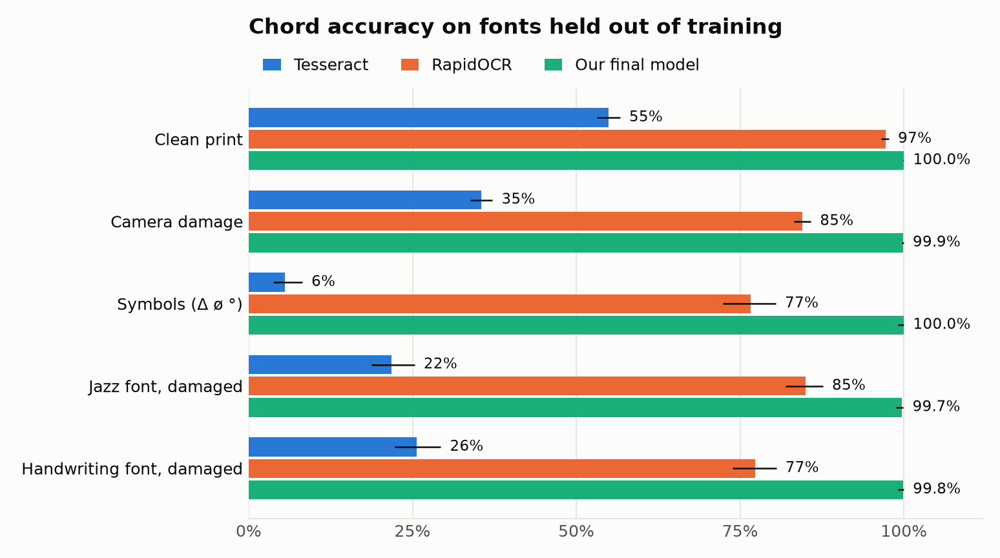

# xrnsheet: reading jazz sheet music from a photo

I play jazz and classical music and scan a lot of sheets. xrnsheet is a web app that turns a photo or PDF of a sheet into notation you can correct and reprint. I built it to learn how a machine learning product works from data to interface, to use on my own music, and to find out whether it could become a startup.

The concepts behind the project are in [KNOWLEDGE_GUIDE.md](KNOWLEDGE_GUIDE.md).

## Results at a glance

**The app works end to end on clean, computer-rendered sheets, and it isn't ready for real handwriting.** My chord reader scored 99.9% on unseen fonts, but that number says little about real use. On the one real handwritten page I tested end to end, it found 20 of 53 chords.

| Measure | Result |
|---|---|
| Chord recall on hard synthetic charts, clean | 0.93 (Audiveris: 0.25) |
| Chord recall on hard synthetic charts, simulated photo | 0.93 (Audiveris: 0.16) |
| Chord accuracy on 6,000 crops in unseen fonts | 99.9% (RapidOCR: 90.8%, Tesseract: 45.2%) |
| Real handwritten page, chords cropped by hand | 41/53, or 77% (RapidOCR: 49%) |
| Real handwritten page, end to end | 20/53, or 38% (RapidOCR: 11%) |
| A second writer, never used for tuning | 4/8 (RapidOCR: 4/8) |

Everything except the last three rows is synthetic. No real phone photo or real printed page has been tested yet, so these scores don't show real-world accuracy.

Three things I'm proudest of aren't in that table:

- The benchmark changed my plan before I'd trained anything.
- Removing one augmentation showed it was responsible for almost all of the model's ability to read damaged images.
- The biggest gain in the project came from fixing about 40 lines of box handling, not from the model.


## The goal

The product idea is simple: photograph a sheet, get editable notation, fix what's wrong, and print a clean PDF. Good products already exist. Soundslice, PlayScore 2, ScanScore and SmartScore all do parts of this, and MuseScore can import PDFs through Audiveris. I haven't tested the commercial apps, so I can't say how they compare.

My goal was to learn by building it, so using an existing engine for everything wasn't enough. The question I set for the model was narrower: what part of this could I build and train myself, on a laptop with a 4 GB GPU, that would really add something?

## Step 1: Measure before building

Before training anything, I built a benchmark. It renders scores into images, so the correct answer for every image is known exactly. Each piece appears as a clean print, in a handwritten-style music font, and as a simulated phone photo.

Both engines read notes well on clean print. The first big finding was about chords:

- homr, the stronger note reader, writes no chord symbols.
- Audiveris read chords without flats but failed on chords with them.

That moved my first model from a melody reader, which would only copy what already worked, to a chord symbol reader.

The benchmark also caught several of my own bugs. Audiveris sometimes splits one sheet into two files, and my scorer was reading only the first. Lyrics such as "Am" counted as chords. One misread clef sank a whole page, so I added a score that ignores octaves. Each of these bugs had produced a believable table, which taught me to check surprising scores against raw output.

## Step 2: A baseline changed the question

I then tested a modern free OCR, RapidOCR, on chord crops. It scored 90.8%, far above Tesseract's 45.2%. So the "chord gap" was partly a Tesseract gap. That raised the bar for my model, and it also meant I could no longer claim chords were unsolved.

The test set was built to be hard to fool:

- 31 fonts, split into 22 for training, 4 for validation and 5 for testing, so the test fonts are never seen in training.
- 6,000 frozen crops across clean and damaged images.
- Chords scored by meaning, so `C-7` and `Cm7` count as the same answer.

## Step 3: The chord reader

I trained a CRNN with CTC loss: a CNN reads the shapes, a bidirectional LSTM reads along the line, and CTC removes the need to mark where each character sits. It has 2.8 million parameters and took 34 minutes to train for 24,000 steps on my GPU.

There's no large free set of labelled chord images, so all training data is synthetic. Each image is a chord in a random font with stems, staff lines and camera damage added. Other text and noteheads are included as "not a chord" examples.

The first model scored 99.6%. An ablation showed why:

| Trained | Clean images | Damaged images |
|---|---|---|
| With camera damage | 99.8% | 99.3% |
| Without camera damage | 97.4% | 1.6% |

Without augmentation the model can barely read a damaged image at all. Augmentation even helped on clean images.

## Step 4: The app

The pipeline is a chain of replaceable steps, so the note engine can be swapped later without touching the rest.

```
photo or PDF
   → homr: notes and staff positions
   → RapidOCR detector: text boxes
   → chord box logic: one box per chord
   → my chord reader: text and confidence
   → alignment: attach each chord to a measure and beat
   → MusicXML → web editor → PDF
```

The app is a small FastAPI server with a plain JavaScript interface. It shows the original beside the recognized score, marks chords it's unsure about, and lets you fix notes and chords with clicks or the keyboard. Each edit saves a new file, so undo just goes back one.

I tested it in a real headless browser, because passing API tests don't prove an interface works. That found real problems, such as notes being too small to click reliably.

## Step 5: The reality check

At this point I had a 99.6% model, and I nearly stopped there. Two numbers made me keep going.

**Validation disagreed with the test.** The handwriting fonts in validation scored 76% and 93%, while the handwriting font in my test set scored 98.5%. My test font was simply easy.

**I found a real page.** The JAZZMUS paper ([arXiv 2509.05329](https://arxiv.org/abs/2509.05329)) shows a real handwritten lead sheet that its authors call particularly problematic. I transcribed its 53 chords, checked my transcription against crops, and tested on it. I kept the image out of this repository, because it isn't mine to share.

| Test | First model |
|---|---|
| Unseen fonts | 99.6% |
| Same page, chords cropped by hand | 60% (32/53) |
| Same page, end to end | 13% (7/53, plus 28 false chords) |

RapidOCR scored 49% on the crops. My model's lead looked good, but McNemar's test gave p = 0.26, so that page couldn't separate them.

This was the most useful moment in the project. The model's errors had a pattern: the raised `7`, wide gaps, sharps cut through letters. And the drop from 60% to 13% meant most of the loss wasn't in the model at all.

## Step 6: The problem was the boxes

I drew every detected box on the page, which explained the 13% immediately. The text detector was built for sentences, and it fails on chords in two opposite ways.

| Failure | Where | What happened |
|---|---|---|
| Glued chords | Printed charts | `Abmin7b5 F#7` came as one box. It read correctly, then failed to parse as one chord and was thrown away |
| Broken chords | Handwriting | `E7` came as `E` and `7`, and the `E` passed as a wrong chord |
| Lost chords | Tight staves | My own lyric filter rejected real chords |
| Tilted crops | Handwriting | A raised `7` tilted the box, which rotated the crop |

The glued case had been there since my first pipeline run, even on perfect images. I saw 12 of 23 chords early on and blamed an unfinished checkpoint. That was a mistake: the final model gave the same result, and I should have traced it the first time.

The fixes went into `pipeline/chord_boxes.py`. Failed boxes are cut at white gaps, the pieces are read, and dynamic programming picks the best explanation. Fragments join the chord on their left. Lyrics are judged by a whole row, not by distance.

| Chords found, 11 synthetic pages | Correct | False |
|---|---|---|
| Before the fixes | 140/207 (68%) | 1 |
| After the fixes, same model | 192/207 (93%) | 4 |

Nothing was retrained. This also showed something uncomfortable: with good boxes, RapidOCR reaches 189/207. **On rendered print, my model has almost no advantage over a free reader.**

## Step 7: A second model built on real errors

I tested the idea that handwriting errors come from layout, using two changes.

**Handwriting layout.** 35% of training chords are now drawn one character at a time, with raised extensions, wide gaps, tall sharps through letters, crossed sevens and slurs. My first version distorted the images until nobody could read them. Looking at samples caught that before I wasted a training run.

**Better negatives.** I made a sheet of the real false chords. Almost all were pieces of staff with pen strokes through them, read as `F` or `E`. So I generated those as "not a chord" images.

I set the promotion rules before looking at the results: the test score had to stay at 99% or above, real crops had to improve, and printed pages couldn't get worse. All three passed. Every row below already includes the box fixes from step 6.

| Test | First model | Final model | RapidOCR |
|---|---|---|---|
| Unseen fonts | 99.6% | 99.9% | 90.8% |
| Hardest validation font, clean | 75.8% | 99.0% | not measured |
| Real page, cropped by hand | 32/53 | 41/53 | 26/53 |
| Real page, end to end | 18/53 | 20/53 | 6/53 |
| False chords on that page | 40 | 13 | 14 |
| Synthetic pages | 192/207 | 195/207 | 189/207 |
| Second writer | 3/8 | 4/8 | 4/8 |

On the real page's crops, the final model beats RapidOCR (p = 0.006) and my first model (p = 0.049). Those p-values need a caveat: **that page shaped the changes, so it's a development page, not a test.** The only independent check is 8 chords from a second writer, and there the model tied with RapidOCR. So I can say the changes fixed the problems I aimed them at. I can't say they solved handwriting.


## Final results

Synthetic pages, as chord recall / correct placement. Audiveris runs as it comes, and the RapidOCR column is my pipeline with RapidOCR as the reader.

| Sheets | Audiveris | RapidOCR | xrnsheet |
|---|---|---|---|
| Spelled jazz charts, clean (10) | 0.25 / 0.19 | 0.91 / 0.85 | 0.93 / 0.88 |
| Spelled jazz charts, simulated photo (10) | 0.16 / 0.08 | 0.89 / 0.82 | 0.93 / 0.87 |
| Lead sheets, clean (3) | 0.63 / 0.63 | 1.00 / 0.96 | 1.00 / 0.96 |
| Lead sheets, handwritten-style font (3) | 0.53 / 0.53 | 1.00 / 1.00 | 1.00 / 1.00 |
| Lead sheets, simulated photo (3) | 0.43 / 0.30 | 1.00 / 1.00 | 0.98 / 0.98 |

Notes as F1, which come from homr in my pipeline. Audiveris failed on 2 sheets, which count as 0.

| Sheets | homr | Audiveris |
|---|---|---|
| Classical, clean (5) | 0.97 | 0.95 |
| Classical, handwritten-style font (5) | 0.93 | 0.51 |
| Classical, simulated photo (5) | 0.82 | 0.27 |
| Jazz charts, clean (13) | 1.00 | 0.99 |
| Jazz charts, simulated photo (13) | 1.00 | 0.91 |

homr's scores are inflated, because its training data overlaps with how my images are made. On the real handwritten page it found all 7 staves, but the result was close to useless, with the wrong key and rhythm.



A page takes 15 to 30 seconds on CPU. The test suite has 141 tests.

## Mistakes I made

- **I trusted a good number.** 99.6% was real but answered a narrower question than I thought.
- **I explained away a bad number.** The 12/23 result looked like an unfinished model, so I didn't trace it. It was the biggest bug in the project.
- **I tuned a rule to my own data.** My lyric filter worked on synthetic pages because they have generous spacing, and it deleted real chords on the first real page.
- **I wrote tests that couldn't fail.** When I put old bugs back on purpose, 2 of 8 got through, including a test font moving into training.
- **I tried a fix that made things worse.** I detected barlines from the image to improve placement. It helped on clean pages, but on photos it found wrong barlines whose count happened to match, and placement fell from 185 to 171 of 207. I removed it.

## What doesn't work yet

- **Real photos and real printed pages are untested.** The photo condition is simulated.
- **Handwriting is weak.** The end-to-end result is 38% on one page, chosen because it's difficult, plus 13 false chords.
- **Notes on handwriting are poor.** That comes from homr, and I haven't worked on it.
- **Placement is weaker than recall.** About 5 points are lost, mostly late on the page, where note counts stop matching. homr 0.7 doesn't report barlines. A newer unreleased version reports positions directly, but I couldn't install it in this setup.
- **False symbols appear.** homr adds about one false fermata per page. "Clear marks" fixes them one click at a time.
- **Only the first page of a PDF is read.**
- **Evidence is thin.** One real page, one short strip, and my own transcription.

## What I'd do next

1. **Photograph real printed sheets** and score them, using the same pieces so the answers are known. It's the cheapest test I haven't run, and the one that matters most.
2. **Request JAZZMUS access**, for real handwritten pages with labels. It's non-commercial, so it could be used for testing and learning, but not for a commercial model.
3. **Test Soundslice** on the same sheets. If it already reads chords well, the startup case changes.
4. **Use a separate real test set.** Label a few pages and never tune on them.
5. **Train a chord detector**, if real labels appear. Most losses are in the boxes, so this is likely worth more than a better reader.
6. **Use the free reader on print** and keep my model for handwriting, if real data supports that.

## Could it be a startup?

Not yet. The honest case is that chord symbols on messy jazz charts may be an underserved niche, but I've measured only a small part of that claim. Two blockers remain: homr and Audiveris are AGPL, so a closed product needs another note engine or an open source release, and the best real data can't be used commercially. My chord model looks like the safest part to ship, because it's trained on open-licensed fonts, but a real product would need proper legal advice.

## Run it

```sh
.venv/bin/python -m app.server            # open http://127.0.0.1:8000
.venv/bin/python -m pytest tests -q       # run the tests
.venv/bin/python bench/run_engines.py     # rerun the benchmark
```

Setup and every other command are in the [README](../README.md).
