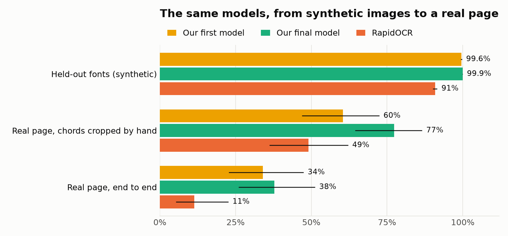
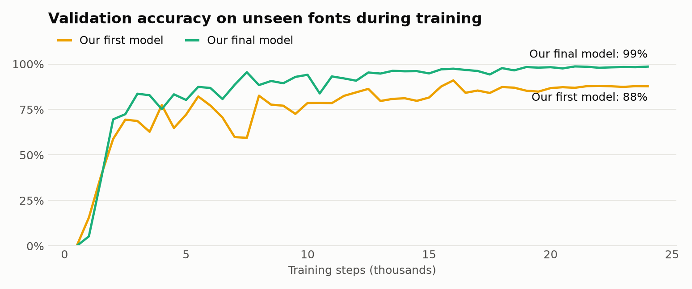

# xrnsheet: reading jazz sheet music from a photo

I play jazz and classical music and scan a lot of sheets. xrnsheet is a web app that turns a photo or PDF of a sheet into notation you can correct and reprint. I built it to learn how a machine learning product works from data to interface, to use on my own music, and to find out whether it could become a startup.

The concepts behind the project are in [KNOWLEDGE_GUIDE.md](KNOWLEDGE_GUIDE.md).

## Results at a glance

**The app works end to end on clean, computer-rendered sheets, and it isn't ready for real handwriting.** My chord reader scored 99.9% on unseen fonts, but that number says little about real use. On the one real handwritten page I tested end to end, it found 20 of 53 chords. My own note reader matches homr on synthetic melody sheets and places chords better, and it fails on real handwritten notes. The score editor is finished as far as my tests can show, but nobody has used it on a real piece.

| Measure | Result |
|---|---|
| Chord recall on hard synthetic charts, clean | 0.93 (Audiveris: 0.25) |
| Chord recall on hard synthetic charts, simulated photo | 0.93 (Audiveris: 0.16) |
| Chord accuracy on 6,000 crops in unseen fonts | 99.9% (RapidOCR: 90.8%, Tesseract: 45.2%) |
| My note reader on 29 melody pages, note F1 | 1.00 (homr: 1.00) |
| Chords in the right place on those pages | 537/579 (with homr: 518/579) |
| 3/4 sheets with the right time signature | 1.00 (homr alone: 0.50) |
| Real handwritten page, chords cropped by hand | 41/53, or 77% (RapidOCR: 49%) |
| Real handwritten page, end to end | 20/53, or 38% (RapidOCR: 11%) |
| A second writer, never used for tuning | 4/8 (RapidOCR: 4/8) |
| Retraining on 42 real chords, tested on the rest of that page | 43/53 against 41/53, p = 0.77 |

The first six rows are synthetic. No real phone photo or real printed page has been tested yet, so these scores don't show real-world accuracy.

The 29 melody pages include three lead sheets, and one of them has since been replaced; see [Final results](#final-results).

Three things I'm proudest of aren't in that table:

- The benchmark changed my plan before I'd trained anything.
- Removing one augmentation showed it was responsible for almost all of the model's ability to read damaged images.
- The biggest gain in the project came from fixing about 40 lines of box handling, not from the model.



## The goal

The product idea is simple: photograph a sheet, get editable notation, fix what's wrong, and print a clean PDF. Good products already exist. Soundslice, PlayScore 2, ScanScore and SmartScore all do parts of this, and MuseScore can import PDFs through Audiveris. I haven't tested the commercial apps, so I can't say how they compare.

My goal was to learn by building it, so using an existing engine for everything wasn't enough. The question I set for the model was narrower: what part of this could I build and train myself, on a laptop with a 4 GB GPU, that would really add something?

## Step 1: Measure before building

Before training anything, I built a benchmark. It renders scores into images, so the correct answer for every image is known exactly. Each piece appears as a clean print, in a handwritten-style music font, and as a simulated phone photo.

Both engines read notes well on clean print. The first big finding was about chords:

- homr, the stronger note reader, writes no chord symbols.
- Audiveris read chords without flats but failed on chords with them.

That moved my first model from a melody reader, which would only copy what already worked, to a chord symbol reader.

The benchmark also caught several of my own bugs. Audiveris sometimes splits one sheet into two files, and my scorer was reading only the first. Lyrics such as "Am" counted as chords. One misread clef sank a whole page, so I added a score that ignores octaves. Each of these bugs had produced a believable table, which taught me to check surprising scores against raw output.

## Step 2: A baseline changed the question

I then tested a modern free OCR, RapidOCR, on chord crops. It scored 90.8%, far above Tesseract's 45.2%. So the "chord gap" was partly a Tesseract gap. That raised the bar for my model, and it also meant I could no longer claim chords were unsolved.

The test set was built to be hard to fool:

- 31 fonts, split into 22 for training, 4 for validation and 5 for testing, so the test fonts are never seen in training.
- 6,000 frozen crops across clean and damaged images.
- Chords scored by meaning, so `C-7` and `Cm7` count as the same answer.

## Step 3: The chord reader

I trained a CRNN with CTC loss: a CNN reads the shapes, a bidirectional LSTM reads along the line, and CTC removes the need to mark where each character sits. It has 2.8 million parameters and took 34 minutes to train for 24,000 steps on my GPU.

There's no large free set of labelled chord images, so all training data is synthetic. Each image is a chord in a random font with stems, staff lines and camera damage added. Other text and noteheads are included as "not a chord" examples.

The first model scored 99.6%. An ablation showed why:

| Trained | Clean images | Damaged images |
|---|---|---|
| With camera damage | 99.8% | 99.3% |
| Without camera damage | 97.4% | 1.6% |

Without augmentation the model can barely read a damaged image at all. Augmentation even helped on clean images.

## Step 4: The app

The pipeline is a chain of replaceable steps, so the note engine can be swapped later without touching the rest.

```
photo or PDF
   → homr: notes and staff positions
   → RapidOCR detector: text boxes
   → chord box logic: one box per chord
   → my chord reader: text and confidence
   → alignment: attach each chord to a measure and beat
   → MusicXML → web editor → PDF
```

The app is a small FastAPI server with a plain JavaScript interface. It shows the original beside the recognized score, marks chords it's unsure about, and lets you fix notes and chords with clicks or the keyboard. Each edit saves a new file, so undo just goes back one.

I tested it in a real headless browser, because passing API tests don't prove an interface works. That found real problems, such as notes being too small to click reliably.

## Step 5: The reality check

At this point I had a 99.6% model, and I nearly stopped there. Two numbers made me keep going.

**Validation disagreed with the test.** The handwriting fonts in validation scored 76% and 93%, while the handwriting font in my test set scored 98.5%. My test font was simply easy.

**I found a real page.** The JAZZMUS paper ([arXiv 2509.05329](https://arxiv.org/abs/2509.05329)) shows a real handwritten lead sheet that its authors call particularly problematic. I transcribed its 53 chords, checked my transcription against crops, and tested on it. I kept the image out of this repository, because it isn't mine to share.

| Test | First model |
|---|---|
| Unseen fonts | 99.6% |
| Same page, chords cropped by hand | 60% (32/53) |
| Same page, end to end | 13% (7/53, plus 28 false chords) |

RapidOCR scored 49% on the crops. My model's lead looked good, but McNemar's test gave p = 0.26, so that page couldn't separate them.

This was the most useful moment in the project. The model's errors had a pattern: the raised `7`, wide gaps, sharps cut through letters. And the drop from 60% to 13% meant most of the loss wasn't in the model at all.

## Step 6: The problem was the boxes

I drew every detected box on the page, which explained the 13% immediately. The text detector was built for sentences, and it fails on chords in two opposite ways.

| Failure | Where | What happened |
|---|---|---|
| Glued chords | Printed charts | `Abmin7b5 F#7` came as one box. It read correctly, then failed to parse as one chord and was thrown away |
| Broken chords | Handwriting | `E7` came as `E` and `7`, and the `E` passed as a wrong chord |
| Lost chords | Tight staves | My own lyric filter rejected real chords |
| Tilted crops | Handwriting | A raised `7` tilted the box, which rotated the crop |

The glued case had been there since my first pipeline run, even on perfect images. I saw 12 of 23 chords early on and blamed an unfinished checkpoint. That was a mistake: the final model gave the same result, and I should have traced it the first time.

The fixes went into `pipeline/chord_boxes.py`. Failed boxes are cut at white gaps, the pieces are read, and dynamic programming picks the best explanation. Fragments join the chord on their left. Lyrics are judged by a whole row, not by distance.

| Chords found, 12 synthetic pages | Correct | False |
|---|---|---|
| Before the fixes | 140/207 (68%) | 1 |
| After the fixes, same model | 192/207 (93%) | 4 |

One of the 12 pages has no chords, and it's there to count false ones. Nothing was retrained. This also showed something uncomfortable: with good boxes, RapidOCR reaches 189/207. **On rendered print, my model has almost no advantage over a free reader.**

## Step 7: A second model built on real errors

I tested the idea that handwriting errors come from layout, using two changes.

**Handwriting layout.** 35% of training chords are now drawn one character at a time, with raised extensions, wide gaps, tall sharps through letters, crossed sevens and slurs. My first version distorted the images until nobody could read them. Looking at samples caught that before I wasted a training run.

**Better negatives.** I made a sheet of the real false chords. Almost all were pieces of staff with pen strokes through them, read as `F` or `E`. So I generated those as "not a chord" images.

I set the promotion rules before looking at the results: the test score had to stay at 99% or above, real crops had to improve, and printed pages couldn't get worse. All three passed. Every row below already includes the box fixes from step 6.

| Test | First model | Final model | RapidOCR |
|---|---|---|---|
| Unseen fonts | 99.6% | 99.9% | 90.8% |
| Hardest validation font, clean | 75.8% | 99.0% | not measured |
| Real page, cropped by hand | 32/53 | 41/53 | 26/53 |
| Real page, end to end | 18/53 | 20/53 | 6/53 |
| False chords on that page | 40 | 13 | 14 |
| Synthetic pages | 192/207 | 195/207 | 189/207 |
| Second writer | 3/8 | 4/8 | 4/8 |

On the real page's crops, the final model beats RapidOCR (p = 0.006) and my first model (p = 0.049). Those p-values need a caveat: **that page shaped the changes, so it's a development page, not a test.** The only independent check is 8 chords from a second writer, and there the model tied with RapidOCR. So I can say the changes fixed the problems I aimed them at. I can't say they solved handwriting.



## Step 8: Making it usable on real sheets

To use this on my own music, it needed a few things that aren't machine learning.

- **Multi-page PDFs.** Each page is read in its own process with a time limit, then the pages are joined into one score. If a page fails, it's left out and the app says which one, so a blank page doesn't lose the whole piece.
- **Saved sheets.** The start page lists earlier sheets, and they reopen where I left them.
- **"Mark as checked".** This records that a person really reviewed a sheet, which step 9 depends on.

A screenshot caught a bug that tests hadn't: a clef and `4/4` appeared in the middle of a line, wherever one page ended and the next began. Pages state their signatures at the top, so joining them repeated those signs. They're now kept only when they change.

I tested this in a real browser with a three-page PDF whose middle page was blank. The app showed its progress, reported "Couldn't read page 2, so it was left out", and gave 37 chords on 2 pages. Editing, marking as checked, exporting a PDF, reopening and reloading all kept their state, and nothing overflowed at phone width.

## Step 9: Would real corrections improve the model?

The plan was that using the app creates training data. I built that loop, then tested whether it could work before asking for weeks of corrections.

`chords.corrections` compares a checked sheet's first and final versions, and labels each chord as confirmed, corrected, moved or removed. Similar sheets stay together, so a piece scanned twice can't sit on both sides of the split. One group in five is held out, chosen by a hash. `chords.retrain` then fine-tunes a candidate model, which replaces the live one only if it passes rules I fixed before any real data existed: at least 30 held-out chords, 0.99 or above on the synthetic test, more chords gained than lost, and McNemar p below 0.05.

I had no real corrections, so I ran the whole loop with a simulated user on 20 sheets through the real API, plus the browser job from step 8. That gave 459 chords: 427 confirmed, 7 corrected, 25 moved and none removed. It also found a serious bug. On the first run, 28 chords counted as "removed", which would have taught the model that real chords aren't chords. They had really just been misplaced, and the simulated user deleted them and added them nearby. The retraining tool then ran through its real command, both models scored 88/88, and the gate correctly refused to promote. **These numbers only show that the loop works, not that the model is accurate.**

To test the idea with real handwriting, I used 5-fold cross-validation on the real page. Each fold trains on some chords and tests on the ones it didn't see, so every chord is tested once.

| Real chords used to train | Right, of 53 | Gained | Lost | McNemar p | Second writer, of 8 |
|---|---|---|---|---|---|
| None, the current model | 41 | | | | 4 |
| 10, 500 steps | 41 | 6 | 6 | 1.00 | 4.8 |
| 20, 500 steps | 40 | 5 | 6 | 1.00 | 5.0 |
| 42, 500 steps | 41 | 7 | 7 | 1.00 | 4.8 |
| 42, 1,500 steps | 43 | 7 | 5 | 0.77 | 4.8 |

The scripts behind this table were lost when a reboot emptied `/tmp`. I rebuilt them as `bench/real_page.py`, and the rerun matched every 500-step row exactly.

**A few dozen real corrections haven't been shown to help.** Fine-tuning changed which chords were right, but not how many. The best result is within chance, and the second writer's average is only a small, unproven rise. This is a harsh test, because that page already shaped the current model, but it still changes my plan. Correcting sheets is useful for finding what fails, and I shouldn't expect it to retrain the model until I have much more data.

## Step 10: My own note reader

homr's AGPL licence is a problem for a product, and homr 0.7 doesn't report barlines, which is why chord placement stayed below recall. I also came here to learn how to build this. So I built a note reader for the simplest useful case: one melody on one staff, which covers lead sheets and most jazz charts.

**Finding staves.** This part is classical computer vision, with no neural network. It traces five evenly spaced lines across the page and fits a curve, so a bent photo can be flattened. My first version counted ink along rows and lost staves on warped photos. The tracing version then invented false staves on 64 of 120 pages, because a ledger line beside four real lines looks like a staff shifted by one. After that fix it got 300 of 300 generated pages right, and 48 of 48 rotated photo pages up to 8 degrees, at about 0.24 seconds a page.

**The model.** It's the same CRNN and CTC design as the chord reader, with one important change: it keeps 6 rows of height, because in a note, height is the pitch. The model has 5.4 million parameters and 269 tokens. A token describes what's printed, such as "a note in staff position 9 that looks like an eighth". Rules then work out the real pitch from the clef, the key and earlier accidentals, the way a musician does.

**Training.** I generated 22,000 pages with random melodies, which gave 54,923 strips, using three music fonts. Leipzig and Petaluma were held out, because the benchmark pages are drawn in them. Before training, a round-trip test checked that 150 of 150 random pages could be rebuilt exactly from their tokens, so I knew the labels were right. Training took about 55 minutes. The system stopped the run for lack of memory after about 23,000 of 24,000 steps, but the best checkpoint, from step 21,000, was already saved and validation had flattened out, so I kept it.

**On unseen fonts.**

| Font | Images | Strips exactly right | Token error |
|---|---|---|---|
| Leipzig | Clean | 97.5% | 0.14% |
| Leipzig | Damaged | 97.5% | 0.17% |
| Petaluma | Clean | 51.8% | 2.77% |
| Petaluma | Damaged | 46.6% | 3.31% |

An average of those would hide the most important result. Petaluma is the hand-style font, so it's the one closest to what I'd actually scan. The biggest single cause is time signatures: only 38 of 250 were read correctly. Ignoring them lifts Petaluma's exact strips to 74%, which is still well below Leipzig's 99%, so there's a second problem I haven't explained. I didn't fix either one, because Petaluma is my held-out font, and tuning on it would leave no clean test.

**On full pages.** Each row is an average across pages, with chords as recall / placement.

| Sheets | Notes: mine | Notes: homr | Chords: mine | Chords: homr |
|---|---|---|---|---|
| Spelled jazz charts, clean (10) | 1.00 | 1.00 | 0.93 / 0.93 | 0.93 / 0.88 |
| Spelled jazz charts, simulated photo (10) | 1.00 | 1.00 | 0.89 / 0.88 | 0.93 / 0.87 |
| Lead sheets, clean (3) | 1.00 | 1.00 | 1.00 / 1.00 | 1.00 / 0.96 |
| Lead sheets, handwritten-style font (3) | 0.99 | 1.00 | 1.00 / 1.00 | 1.00 / 1.00 |
| Lead sheets, simulated photo (3) | 1.00 | 1.00 | 1.00 / 1.00 | 0.98 / 0.98 |
| Classical, clean (5) | 0.12 | 0.97 | n/a | n/a |
| Classical, handwritten-style font (5) | 0.13 | 0.93 | n/a | n/a |
| Classical, simulated photo (5) | 0.12 | 0.82 | n/a | n/a |

These are the numbers at this stage. Step 14 later took my clean charts to 0.94 / 0.94 and my placement total to 537.

Three results stand out.

- **Placement improved, which is what this was for.** Across the 29 melody pages, chords in the right measure and beat rose from 518 to 534 of 579. Paired by chord, my reader alone got 32 and homr alone got 16 (p = 0.03). Chords on one page aren't independent, so that p-value is somewhat optimistic. Recall on simulated photos fell from 0.93 to 0.89, which step 14 traces.
- **Classical sheets fail, as expected.** It reads one melody per staff, so piano and choir music score about 0.12. That's why homr stays the default.
- **It's about four times faster.** A melody page takes 4 seconds, against 16.

Those 1.00 scores need a warning. All three hand-style pages came out as `2/2` when the truth was `4/4`, and my note score can't see that, because it compares only pitch and duration. A musician would see that mistake at once.

**On the real handwritten page.** The staff finder got all 7 lines right, and the number of barlines per line looked about right. The notes failed: it found 27 notes on a page with well over 100, mostly as half notes, and it was confident about them. homr found 69, and its result was also poor. Chord finding held up, at 21/53 with 17 false chords, against 20/53 with 13 false chords with homr. That page is development data, so it only shows what's broken. The reader has never seen handwritten notes in training, and it shows.

## Step 11: An editor of my own

The app could change a pitch or a chord, but it couldn't change a note's length, add a bar, or start from an empty page. So a misread rhythm couldn't be fixed at all. MuseScore does all of this, but it's GPL, so I can't build on its code if this becomes a product. I kept its keyboard conventions and behaviour and wrote my own code.

The first milestone had three parts: write a score from scratch by keyboard, fix anything recognition got wrong, including rhythm and bar counts, and hear the result.

**How it works.** An edited bar is read into a timeline of events at exact positions, changed, and written back whole. Before building on that, I checked that reading and rewriting changes nothing. 106 files and 2,121 bars came back with identical notes and chords. Each bar also keeps a permanent ID, so chord boxes and correction labels survive adding and deleting bars.

**Testing it.** A rhythm bug can look fine on the page, so I tested at four levels:

| Level | What it does | What it caught |
|---|---|---|
| Example tests | One behaviour each, such as a longer note overwriting what follows | Three wrong expectations of my own, where the code was right |
| Random edits | About 5,000 seeded edit attempts with rules checked after each, 1,600 of them compared with a separate 16-slot model of a bar | Half-ties left by moving a note, a gap opened in the wrong place, and a first bar wrongly treated as a pickup |
| Browser | A real browser types, clicks, plays and downloads, with notes typed at full speed | Notes too small to tap on a phone and a stray "Music" label, both seen in its screenshots |
| Bugs put back | Breaking the code on purpose to see whether a test notices | See below |

**Putting bugs back.** I put 18 bugs into the back-end code one at a time, and the tests caught 15. Tracing one miss led to a real bug: writing a quarter note on the second note of a triplet covered the rest of the triplet exactly and left its first note stranded. Every bar still added up, so no rule objected. That write is now refused. The other two misses only needed tests. After that, all 19 back-end bugs, counting one for the new refusal, and all 5 browser bugs were caught, including the two race conditions: without the lock, and without the browser's queue, edits are lost.

**A check that needs no answers.** Notes in a bar must add up to the time signature, which needs no truth file. It raised 0 false alarms on 337 correct bars. On homr's output it found errors my note score can't see, including Schubert read in 4/4 for 3/4, and Joplin notes half a beat late on a page that scored 1.00. The app now lists those bars above the score.

**Speed.** Through the real server, a typed note takes a median of 45 ms on a 32-bar score and 104 ms on 200 bars, including redrawing every page. So drawing can stay on the server.

**Limits at this point.** You couldn't yet click a note onto the staff, enter triplets, or copy and paste. Long notes didn't carry over a barline, playback ignored repeats, and there were no lyrics or printed titles. Step 12 adds all of those.

## Step 12: Finishing the editor

The second milestone added what a real piece needs: clicking notes onto the staff, triplets, long notes that carry over a barline as ties, repeats and first and second endings in playback, copy and paste, selecting a range, lyrics, and a printed title and composer.

**Triplets needed a second length.** A triplet eighth is written as an eighth but lasts a third of a beat, so a note now has a written length and a sounding length. A dotted note inside a triplet can land exactly on a beat, so positions can't show where a triplet ends. The file now stores the group's unit, which settles it. Recognized files often leave that out, and the shortest note stands in for it.

**Everything goes through one queue.** The first milestone queued edits, but a length key still took effect at once. Typing `c d 6 e` quickly gave the half note to the `d` still waiting to be sent. Localhost is so fast that this only showed once I slowed the server down on purpose. Now anything that decides where the next edit lands waits its turn. Text in a form is the opposite: it's read the moment it's typed, because a late reply can redraw the field first.

**Testing sound without ears.** A browser test can't listen, so playback also renders into an `OfflineAudioContext`, which writes the sound to an array. The test measures how strong each pitch is, half a beat at a time. That shows the right pitches at the right moments, and that a tie holds where a repeated note dips. It can't say whether it sounds good.

**Looking at the print.** I printed a score with a title, composer, lyrics, a triplet, a repeat, two endings, a chord and a tie. The music was right, but neighbouring lyric words almost touched and read as one. No test would have caught that.

**A second browser.** Firefox failed a check that Chromium passed. Typing `won-der` on the last note moved to a next note that doesn't exist, so the box closed. Chromium was fast enough to lose the rest of the word silently, and in Firefox those letters reached the editor as commands. So the bug was in every browser, and only the second one made it visible. On the last note the word now stays in the box.

**Bugs put back.** Across this milestone I put back 29 back-end bugs and 20 browser bugs, and every one is now caught. The misses along the way were weak tests, and each was fixed.

**Limits.** D.C. and D.S. aren't followed in playback, and a range covers one voice. No person has listened to the playback yet.

## Step 13: What the note score couldn't see

Step 10 ended on a warning: a page can score 1.00 for notes with the wrong time signature. The bar check in step 11 had found worse, with notes that were right but in the wrong place. So I added two measures: the share of bars with the right signature, and the share of bars that add up. I report them by signature, because 15 of my 18 pieces are in 4/4, and always answering 4/4 would score 0.83.

| True signature | Sheets | homr: right signature | homr: bars adding up | With repairs: right signature | With repairs: bars adding up |
|---|---|---|---|---|---|
| 2/4 | 3 | 1.00 | 0.62 | 1.00 | 0.92 |
| 3/4 | 6 | 0.50 | 0.62 | 1.00 | 0.86 |
| 4/4 | 35 | 0.99 | 0.99 | 0.99 | 0.99 |

Two causes stood out. homr read Schubert's voice in 4/4 and its piano in 3/4, within one score. And it sometimes leaves out the step back between two staves that sound together, so a voice starts late with the right notes.

**Both can be repaired from the notes alone.** `pipeline/repair.py` measures how long the bars really are and sets the signature to match. Then it lays out late voices from the start of the bar, but only when the whole bar then fits. My first version fixed what it could, and that dropped Schumann's note score from 0.914 to 0.887, so a half-fixed bar was worse than leaving it alone. Whole-bar rests get no vote, because they stretch to fit any signature. All 10 bugs I put back into the repairs are now caught.

**The evidence is thin.** 3 of 88 sheets changed signature, all correctly, but they're one piece in three versions. I designed the repairs by looking at Schubert and Joplin, so these gains are development numbers. The other 85 sheets only show that the repairs raise no false alarms. My own reader didn't improve. It reads 4/4 as 2/2 on hand-style pages, and those add up the same, so bar lengths can't separate them.

## Step 14: Tracing the lost chords

Step 10 left a drop on simulated photos, which only happened with my own note reader. I was sure about the cause: the two routes give the text detector different page sizes. I tried five sizes, and none beat the original (0.922 at full size, 0.907 to 0.916 smaller).

So I traced the lost boxes, which is what I should have done first. Each suggested a fix. I tested them all on the same 26 sheets, then ran the survivors on the real page.

| Change | Own reader, clean, of 268 | Own reader, photo, of 268 | Real page with homr | Decision |
|---|---|---|---|---|
| None | 251 | 243 | 20/53, 13 false | |
| Allow 10 pieces in a box, not 6 | 254, and 2 more false | 243 | 20/53, 13 false | Kept |
| Join overlapping failed boxes | 228 | 243 | Not run | Removed |
| Split again at a smaller gap, on top of the 10 pieces | 254 | 245 | 21/53, 17 false | Removed |

**The last row is the one I nearly got wrong.** It gained 2 chords on photos with no new false chords, and I'd already saved those scores. On the real page it found 5 more chords, and 4 of them were false, because a rule that cuts more boxes also cuts handwriting that was never a chord. Two chords on simulated photos aren't worth that.

So the photo drop is explained but not fixed. A photo's boxes come out taller, which pushes the gap between close chords under the limit for splitting them. A fix has to avoid cutting handwriting, and I don't have one yet.

## Step 15: Closing the gap with MuseScore

I compared the editor with MuseScore feature by feature and built most of what a working musician would notice: transposition, four voices on a staff, slurs and hairpins, articulations and ornaments, dynamics, tempo marks, text, grace notes, clefs, 17 instruments in several parts, line breaks, pickup bars, tuplets of 5, 6 and 7, lyric verses, opening MusicXML files, MIDI and audio export, a MIDI keyboard, and dragging notes. Playback now follows dynamics, tempo changes, swing, articulations, ornaments, and D.C. and D.S.

**Transposing is about names, not numbers.** Adding 3 semitones to C gives a note that could be called D♯ or E♭, and only one is right in the new key. So an interval has two parts, letter steps and semitones, and C up a minor third is always E♭. Chord symbols move the same way, and a key that would need too many flats is swapped for the one that sounds the same.

**Some marks belong to notes and some belong to moments.** A staccato sits on a note, so it goes when the note goes. A dynamic or a hairpin belongs to a moment in the bar, so it stays when you change the notes around it. That split decided where each mark lives in the file and what has to be repaired after an edit.

**A mark can be hard to click.** Verovio makes up its own ids for most marks, so I match them to the file by their order in each bar, and leave a bar unclickable if the count disagrees, not guess. A slur is too thin for a click to land on, and its box covers the notes under it, so the app measures the distance to the curve itself. A slur across a line break is drawn in two pieces, and the second has no id, only a class. That would have failed silently, so I checked it.

**Random edits found what I hadn't thought of.** I gave the random test all the new edits, plus new rules: a slur has both ends, a tie leads somewhere, and every score can be drawn, played and saved as MIDI. It failed straight away. Moving a note to another voice crashed on any file with no `<voice>` tag, which is normal in files from other programs. Ties were checked against the next note in the same voice, which might be bars away. Playback also read each bar voice by voice, so a tie from voice 2 into voice 1 reached its end before its start and sounded twice.

**Not every failure was a bug.** Three times the rule was wrong and the editor was right. An extra voice holding only rests looked like a leftover, but someone who types a rest and then a note needs it to survive, so the true rule is that it can always be removed. A dangling tie on Joplin was already in the file before any edit. Voice 5 is usually the main voice of a piano's lower staff. Each time I checked before changing the code, and the check decided which side to fix.

**Looking at the page again.** A dotted tempo printed an empty box where the dot belongs, the private-font problem from earlier. Every test passed, because the text around it was right. It only showed when I rendered one and looked at it. My notes also said rendering raises an error on any unmapped symbol, and it didn't. That check now exists in the tests, and it covers lengths a person can't pick but a file can name.

**Real scores.** The benchmark's pieces came through a pipeline I control, so I also opened 67 scores from the music21 corpus, none of them used in development, and made 19 edits on each. All 67 survived, with 1,212 edits applied and 61 refused with a reason. The bar check flagged 147 bars as too long. I checked those instead of assuming: Monteverdi's parts really do disagree inside a bar, and a Beethoven bar really does hold one sixteenth too many.

**Bugs put back.** I put back 51 bugs, and 41 were caught at once. The other 10 were the most useful part of the stage.

One was removing hairpin repair from every edit. Nothing noticed because the code did nothing: a hairpin belongs to a moment, so a note edit can't hurt it. I deleted the code instead of writing a test to justify it.

The other 9 were weak tests, and each looked fine when I read it. My check that audio never clips couldn't fail, because a 16-bit number can't go over its limit: it wraps round, and a loud sample came out as near silence. My check that arrows stay in a voice passed because, in the middle of a bar, document order happens to agree. Only the last note shows the bug, where the arrow jumped back to the start of the bar. A test that a key waits its turn had nothing waiting. A short drag stayed close enough to reselect the note, which hid the bug. Tests can sit on top of a behaviour without touching it. One gap mattered more than the rest: nothing checked that a transposed sheet stays out of retraining, and that guard is what stops deliberate chord changes becoming wrong training labels. All 50 real bugs are now caught.

The run also taught me about running it. One bug showed as caught when the failure was a typing error of mine in a test file, because the run copied live files. It now works from a frozen copy, starts with a control run that has no bug added, and counts only a failed test.

**Real files say what they say.** The bar check's 26 "short" flags on those 67 scores aren't mistakes in the music: nearly all are one part of a quartet stopping early in the file with no rest written. The flag is accurate about the file, and a musician wouldn't call it an error.

**Limits.** The sound is simple waveforms, so parts can be told apart but nothing sounds like the real instrument. There's no fingering, pedal or 8va line, no cross-staff notes, and a printed part is a copy, not linked to the score. No person has used any of this yet.

## Final results

**One benchmark piece has changed since.** Every lead-sheet figure in this report, and every total over the 29 melody pages or the 13 jazz charts, was measured with 16 bars of Irving Berlin's *Alexander's Ragtime Band* (1911) as the third lead sheet. It's still in copyright outside the US, so on 2026-11-21 it was replaced by the chorus of *Jingle Bells* (James Lord Pierpont, 1857), written out in `bench/make_samples.py`. A run that day, with the code of that day, gives these lead-sheet rows with each piece, as chord recall / placement:

| Lead sheets (3), 2026-11-21 | Audiveris | RapidOCR | xrnsheet | xrnsheet, my note reader |
|---|---|---|---|---|
| Clean, with Berlin | 0.62 / 0.62 | 1.00 / 1.00 | 1.00 / 1.00 | 1.00 / 1.00 |
| Clean, with *Jingle Bells* | 0.68 / 0.64 | 1.00 / 1.00 | 1.00 / 1.00 | 1.00 / 1.00 |
| Handwritten-style font, with Berlin | 0.74 / 0.65 | 1.00 / 1.00 | 0.96 / 0.96 | 0.94 / 0.94 |
| Handwritten-style font, with *Jingle Bells* | 0.83 / 0.70 | 1.00 / 0.93 | 1.00 / 0.93 | 0.95 / 0.95 |
| Simulated photo, with Berlin | 0.51 / 0.39 | 1.00 / 1.00 | 1.00 / 1.00 | 1.00 / 1.00 |
| Simulated photo, with *Jingle Bells* | 0.44 / 0.35 | 1.00 / 0.93 | 1.00 / 0.93 | 1.00 / 1.00 |

Notes on those pages score 1.00 with homr, 0.99 to 1.00 with my reader and 0.84 to 1.00 with Audiveris. Over the 29 melody pages, chords in the right place come to 519/579 with homr and 534/579 with my reader with Berlin's piece, and 522/585 and 540/585 with *Jingle Bells*. The Berlin rows don't match the figures below exactly, because the code has changed since they were measured.

Synthetic pages, as chord recall / correct placement, with homr reading the notes. Audiveris runs as it comes, and the RapidOCR column is my pipeline with RapidOCR as the reader.

| Sheets | Audiveris | RapidOCR | xrnsheet |
|---|---|---|---|
| Spelled jazz charts, clean (10) | 0.25 / 0.19 | 0.91 / 0.85 | 0.93 / 0.88 |
| Spelled jazz charts, simulated photo (10) | 0.16 / 0.08 | 0.89 / 0.82 | 0.93 / 0.87 |
| Lead sheets, clean (3) | 0.63 / 0.63 | 1.00 / 0.96 | 1.00 / 0.96 |
| Lead sheets, handwritten-style font (3) | 0.53 / 0.53 | 1.00 / 1.00 | 1.00 / 1.00 |
| Lead sheets, simulated photo (3) | 0.43 / 0.30 | 1.00 / 1.00 | 0.98 / 0.98 |

Notes as F1, which come from homr in my pipeline, followed by the repairs from step 13. Audiveris failed on 2 sheets, which count as 0.

| Sheets | homr | homr with repairs | Audiveris |
|---|---|---|---|
| Classical, clean (5) | 0.97 | 0.98 | 0.95 |
| Classical, handwritten-style font (5) | 0.93 | 0.94 | 0.51 |
| Classical, simulated photo (5) | 0.82 | 0.83 | 0.27 |
| Jazz charts, clean (13) | 1.00 | 1.00 | 0.99 |
| Jazz charts, simulated photo (13) | 1.00 | 1.00 | 0.91 |

homr's scores are inflated, because its training data overlaps with how my images are made. On the real handwritten page it found all 7 staves, but the result was close to useless, with the wrong key and rhythm.


A page takes 15 to 30 seconds on CPU with homr, and about 4 with my note reader. In the finished editor, a typed note takes a median of 25 ms on a 32-bar score and 60 ms on 200 bars, including redrawing every page. The test suite has 731 tests, plus a browser test with 118 checks that passes in Chromium and Firefox. Results for my note reader are in step 10.

### What it runs on

Everything ran on one laptop: an Intel i7-12700H, 23 GB of RAM, and an NVIDIA RTX 3050 Ti with 4 GB of memory, on CachyOS Linux. Recognition runs on the CPU, and training runs on the GPU. The main software is Python 3.14, PyTorch 2.14, homr 0.7, RapidOCR 3.10, Verovio 6.4, music21 10.5, OpenCV 4.14 and FastAPI 0.162.

## Mistakes I made

- **I trusted a good number.** 99.6% was real but answered a narrower question than I thought.
- **I explained away a bad number.** The 12/23 result looked like an unfinished model, so I didn't trace it. It was the biggest bug in the project.
- **I tuned a rule to my own data.** My lyric filter worked on synthetic pages because they have generous spacing, and it deleted real chords on the first real page.
- **I wrote tests that couldn't fail.** When I put old bugs back on purpose, 2 of 8 got through, including a test font moving into training.
- **I tried a fix that made things worse.** I detected barlines from the image to improve placement. It helped on clean pages, but on photos it found wrong barlines whose count happened to match, and placement fell from 185 to 171 of 207. I removed it.
- **I built a labelling tool that would have taught the model wrong answers.** It treated misplaced chords as false chords. Only a simulated user caught it.
- **I scored the wrong thing and nearly believed it.** My reader's first real-page score was 7/53, which looked like it had wrecked chord finding. The chords were all there, just scrambled by bad measures. Scored in page order, as the homr result was, it's 21/53. I'd also read a Petaluma result as "the notes are fine" before measuring how much the time signatures explained, and they explained only about half.
- **My benchmark can't see every mistake.** A perfect note score sat on top of a wrong time signature on every hand-style page. I only found that by opening the files.
- **I had a theory and acted on it.** I was sure page size caused the photo drop, and spent a run on a detector trial before tracing a single box. It wasn't the cause.
- **I fixed the example in front of me.** Joining overlapping boxes rescued the chord I'd traced and lost 23 others on clean pages.
- **I saved a result before checking the real page.** A second split raised every synthetic score. The real page then showed 4 more false chords, so I removed the rule and reran the benchmark.
- **I half-fixed a bar.** The first voice repair moved what it could, and the note score fell. A repair now fixes a whole bar or leaves it alone.
- **I tested at one speed in one browser.** Two whole classes of bug only appeared with a slowed server or in Firefox.
- **My rule checks had a blind spot.** I checked that every bar adds up after every edit, which felt thorough. A broken triplet passed all of it, because its lengths still added up. Only putting bugs back showed the gap.
- **I counted a typing error as a caught bug.** A mutation run reported a catch that was really my own broken test file. A check needs a control, or it can't tell the two apart.
- **I wrote a test that couldn't fail, again.** "The audio never goes over the limit" is always true of a 16-bit number. Reading a test isn't enough to know it works. Only breaking the code shows that.
- **I wrote a note about a safety check that didn't exist.** My notes said rendering stopped on any unknown music symbol. It never did, and a dotted tempo printed an empty box.

## What doesn't work yet

- **Real photos and real printed pages are untested.** The photo condition is simulated.
- **Handwriting is weak.** The end-to-end result is 38% on one page, chosen because it's difficult, plus 13 false chords.
- **Notes on handwriting are poor,** with homr and with my own reader.
- **My note reader only handles one melody per staff,** so homr stays the default. It also reads hand-style 4/4 as 2/2, which the bar repairs can't fix, because both add up the same.
- **Placement with homr is weaker than recall.** About 5 points are lost, mostly late on the page, where note counts stop matching. homr 0.7 doesn't report barlines. A newer unreleased version reports positions directly, but I couldn't install it in this setup.
- **Retraining isn't shown to help.** The tools work, but a few dozen corrections made no measurable difference.
- **False symbols appear.** homr adds about one false fermata per page. "Clear marks" fixes them one click at a time.
- **Nobody has used the editor on a real piece.** Its tests show that it does what I specified, not that it's pleasant to use. A range covers one voice, and no person has listened to playback.
- **The editor's sound is basic,** and it has no fingering, pedal or 8va lines, no cross-staff notes, and no linked parts.
- **The bar repairs rest on one piece.** The signature repair has only ever changed Schubert.
- **Simulated photos still lose chords with my note reader.** Close chords stay glued together, and the fix I tried added false chords on the real page.
- **Evidence is thin.** One real page, one short strip, and my own transcription.

## What I'd do next

1. **Photograph real printed sheets** and score them, using the same pieces so the answers are known. It's the cheapest test I haven't run, and the one that matters most.
2. **Use it on my own sheets for two or three weeks,** with 5 to 10 pages set aside first as a test I never tune on. `bench/real_report.py` then gives the first honest accuracy on real sheets.
3. **Test Soundslice** on the same sheets, using `--engine soundslice`. If it already reads chords well, the startup case changes.
4. **Teach the note reader handwriting.** It has never seen any, so this needs hand-drawn training data. JAZZMUS could be used for testing and learning, but not for a commercial model.
5. **Teach my note reader more than one voice per staff,** which is what classical music needs. The editor can already hold four.
6. **Train a chord detector**, if real labels appear. Most losses are in the boxes, and step 14 shows that hand-written rules are reaching their limit.
7. **Use the free reader on print** and keep my model for handwriting, if real data supports that.

## Could it be a startup?

Not yet. The honest case is that chord symbols on messy jazz charts may be an underserved niche, but I've measured only a small part of that claim. Two blockers remain: homr and Audiveris are AGPL, so a closed product needs another note engine or an open source release, and the best real data can't be used commercially. My note reader is a first step on the licence problem, because melody sheets can now run without homr, but it isn't a replacement for it. My chord and note models look like the safest parts to ship, because they're trained on open-licensed fonts, but a real product would need proper legal advice.

## Run it

```sh
.venv/bin/python -m app.server            # open http://127.0.0.1:8000
.venv/bin/python -m pytest tests -q       # run the tests
.venv/bin/python bench/run_engines.py     # rerun the benchmark
```

Setup and every other command are in the [README](../README.md).
